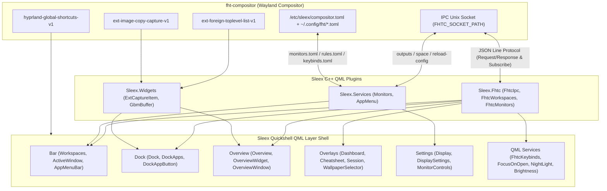

# Sleex Migration Plan: Hyprland to `fht-compositor`

## Goal Description

Migrate **Sleex** (on branch `feat-fht-comp` at `/home/ardox/Documents/axos/sleex`) from **Hyprland** to **`fht-compositor`** (at `/home/ardox/Documents/fht-compositor`), using the older `fht` branch as a historical reference while fixing all stale APIs, serialization bugs, and missing integrations introduced since `fht` diverged from `main`.



---

## User Review Required

> [!IMPORTANT]
> **Targeted `fht-compositor` IPC Enhancements**:
> In `/home/ardox/Documents/fht-compositor`, we will expose two fields on [`fht_compositor_ipc::Window`](file:///home/ardox/Documents/fht-compositor/fht-compositor-ipc/src/lib.rs#L239-L276):
> 1. `wayland_id: Option<String>` (serialized as `"wayland-id"`, from `window.foreign_toplevel_handle().map(|h| h.identifier())`, matching commit `53e0eb3` on `feat-ipc-wayland-id`) so [`ExtCaptureItem`](file:///home/ardox/Documents/axos/sleex/src/share/sleex/plugins/src/Sleex/widgets/ExtCaptureItem.hpp) can match `ext-foreign-toplevel-list-v1` handles in `DockApps.qml` and `OverviewWindow.qml`.
> 2. `pid: Option<u32>` (serialized as `"pid"`, resolved via `get_credentials_for_surface(window.wl_surface())`) so [`sleex::services::AppMenu`](file:///home/ardox/Documents/axos/sleex/src/share/sleex/plugins/src/Sleex/services/appmenu.cpp) can resolve D-Bus `com.canonical.dbusmenu` services by PID. (`AppMenu` will also support fallback when `pid` is absent.)

> [!WARNING]
> **Fixes to Stale/Broken Patterns from the Old `fht` Branch**:
> - **`FhtcIpc::dispatch` Action Serialization**: On `fht`, `Ipc::dispatch` only wrapped actions as JSON objects if `!args.isEmpty() || name.contains("workspace")`, sending unit strings for struct variants like `float-window`, `maximize-window`, `fullscreen-window`, `close-window`, `select-next-layout`, etc. We will serialize unit vs. struct variants accurately according to [`fht_compositor_ipc::Action`](file:///home/ardox/Documents/fht-compositor/fht-compositor-ipc/src/lib.rs#L418-L676) (including required `"kill": false` on `close-window`).
> - **`QJsonDocument` Primitive Handling in `FhtcIpc`**: `QJsonDocument::fromJson` rejects top-level JSON strings such as `"noop"`, and `QJsonDocument::fromVariant` rejects `"subscribe"`. We will handle string primitives directly in `Ipc::writeJson` and `Ipc::parseLine`.
> - **Shared IPC Connection**: `FhtcMonitors` and `FhtcWorkspaces` will share the `FhtcIpc` singleton instance rather than opening redundant event sockets.
> - **Preserving `Appearance.sizes.hyprlandGapsOut`**: [`SizesGroup`](file:///home/ardox/Documents/axos/sleex-ui-kit/src/src/Appearance/Appearance.hpp#L479) in `sleex-ui-kit` exposes `hyprlandGapsOut` (not `gapsOut`). We will keep `Appearance.sizes.hyprlandGapsOut` in `Dock*.qml` so layout bindings do not evaluate to `undefined`.
> - **Fixing Chained `===` Bug in `focusedScreen`**: On `fht`, `OnScreenDisplayBrightness.qml`, `OnScreenDisplayVolume.qml`, and `Display.qml` had `Quickshell.screens.find(s => s.name === FhtcMonitors.activeMonitorName === screen.name)`. We will use `Quickshell.screens.find(s => s.name === FhtcMonitors.activeMonitorName) ?? null`.

---

## Proposed Changes

### 1. `fht-compositor` IPC (`~/Documents/fht-compositor`)

#### [MODIFY] [lib.rs](file:///home/ardox/Documents/fht-compositor/fht-compositor-ipc/src/lib.rs)
- Add `pub wayland_id: Option<String>` and `pub pid: Option<u32>` (with `#[serde(default)]`) to `Window`.
- Fix the broken doc-comment attribute on `Action::FocusWorkspaceByIndex` (`#[serde(rename = "workspace-idx", alias = "workspace_idx")]`) so both `"workspace-idx"` and `"workspace_idx"` deserialize cleanly, and add `#[serde(default)]` to `CloseWindow::kill`.

#### [MODIFY] [subscribe.rs](file:///home/ardox/Documents/fht-compositor/src/ipc/subscribe.rs)
- Populate `wayland_id: window.foreign_toplevel_handle().map(|h| h.identifier())` and `pid: crate::utils::get_credentials_for_surface(window.wl_surface()).map(|c| c.pid as u32)` when constructing `fht_compositor_ipc::Window`.

---

### 2. Core C++ Compositor & Capture Plugins (`src/share/sleex/plugins/src/Sleex/`)

All C++ classes and functions will include thorough docstrings documenting every public/protected/private function and its parameters.

#### [MODIFY] [CMakeLists.txt](file:///home/ardox/Documents/axos/sleex/src/share/sleex/plugins/src/Sleex/CMakeLists.txt)
- Add `add_subdirectory(fhtc)` and ensure modern Qt 6 CMake conventions are followed.

#### [NEW] [CMakeLists.txt](file:///home/ardox/Documents/axos/sleex/src/share/sleex/plugins/src/Sleex/fhtc/CMakeLists.txt)
- Define `qml_module(sleex-fhtc URI Sleex.Fhtc ...)` linking `Qt6::Core`, `Qt6::Qml`, `Qt6::Network`.

#### [NEW] [ipc.hpp](file:///home/ardox/Documents/axos/sleex/src/share/sleex/plugins/src/Sleex/fhtc/ipc.hpp) & [ipc.cpp](file:///home/ardox/Documents/axos/sleex/src/share/sleex/plugins/src/Sleex/fhtc/ipc.cpp)
- Implement `Ipc` (`QML_NAMED_ELEMENT(FhtcIpc)`, `QML_SINGLETON`) with a shared `static Ipc *instance()` accessor so `Monitors`, `Workspaces`, and C++ services can reuse the same event stream and request queue.
- Support both JSON object/array payloads and top-level JSON string requests/responses (`"subscribe"`, `"outputs"`, `"space"`, `"windows"`, `"noop"`).
- Implement `dispatch(const QString &name, const QVariantMap &args = {})` with exact knowledge of `fht-compositor` unit actions (`quit`, `disable-outputs`, `reload-config`, `focus-next-output`, `focus-previous-output`) vs. struct actions (automatically injecting `"kill": false` for `close-window` if not provided).
- Document every method with C++ doc comments.

#### [NEW] [monitors.hpp](file:///home/ardox/Documents/axos/sleex/src/share/sleex/plugins/src/Sleex/fhtc/monitors.hpp) & [monitors.cpp](file:///home/ardox/Documents/axos/sleex/src/share/sleex/plugins/src/Sleex/fhtc/monitors.cpp)
- Implement `Monitors` (`QML_NAMED_ELEMENT(FhtcMonitors)`, `QML_SINGLETON`) exposing `monitors`, `activeMonitor`, and `activeMonitorName`, connected to `Ipc::instance()`.
- Document all methods and properties.

#### [NEW] [workspaces.hpp](file:///home/ardox/Documents/axos/sleex/src/share/sleex/plugins/src/Sleex/fhtc/workspaces.hpp) & [workspaces.cpp](file:///home/ardox/Documents/axos/sleex/src/share/sleex/plugins/src/Sleex/fhtc/workspaces.cpp)
- Implement `Workspaces` (`QML_NAMED_ELEMENT(FhtcWorkspaces)`, `QML_SINGLETON`) exposing `windows`, `workspaces`, `focusedWindowId`, `focusedWindow`, `activeWorkspaceId`, `activeWorkspace`, plus a `windowOpened(QVariantMap window)` signal emitted when a new window ID appears in `window-changed` (used by `FocusOnOpen.qml`).
- Document all methods and properties.

#### [NEW] [plugin.cpp](file:///home/ardox/Documents/axos/sleex/src/share/sleex/plugins/src/Sleex/fhtc/plugin.cpp)
- QML extension plugin entry point for `Sleex.Fhtc`.

#### [MODIFY] [CMakeLists.txt](file:///home/ardox/Documents/axos/sleex/src/share/sleex/plugins/src/Sleex/widgets/CMakeLists.txt)
- Add `wayland-scanner` protocol generation for `ext-image-copy-capture-v1`, `ext-image-capture-source-v1`, `ext-foreign-toplevel-list-v1`, and `linux-dmabuf-unstable-v1`.
- Build `ExtCaptureItem.cpp` and `GbmBuffer.cpp` into `Sleex.Widgets` and link `Qt6::GuiPrivate`, `PkgConfig::WAYLAND_CLIENT`, `PkgConfig::GBM`, `PkgConfig::DRM`, `PkgConfig::EGL`, `PkgConfig::GLESv2`.

#### [NEW] [ExtCaptureItem.hpp](file:///home/ardox/Documents/axos/sleex/src/share/sleex/plugins/src/Sleex/widgets/ExtCaptureItem.hpp) & [ExtCaptureItem.cpp](file:///home/ardox/Documents/axos/sleex/src/share/sleex/plugins/src/Sleex/widgets/ExtCaptureItem.cpp)
- Port `ExtCaptureItem` from `fht` with complete function documentation and add a `hasContent` property (`Q_PROPERTY(bool hasContent READ hasContent NOTIFY hasContentChanged)`) and `constraintSize` property compatibility so `DockApps.qml` and `OverviewWindow.qml` can use `ExtCaptureItem` as a direct drop-in replacement for `ScreencopyView`.

#### [NEW] [GbmBuffer.hpp](file:///home/ardox/Documents/axos/sleex/src/share/sleex/plugins/src/Sleex/widgets/GbmBuffer.hpp) & [GbmBuffer.cpp](file:///home/ardox/Documents/axos/sleex/src/share/sleex/plugins/src/Sleex/widgets/GbmBuffer.cpp)
- Port `GbmBuffer` DMA-BUF/EGL texture wrapper from `fht` with complete function documentation.

---

### 3. C++ Services Migration (`Sleex.Services`)

#### [MODIFY] [appmenu.hpp](file:///home/ardox/Documents/axos/sleex/src/share/sleex/plugins/src/Sleex/services/appmenu.hpp) & [appmenu.cpp](file:///home/ardox/Documents/axos/sleex/src/share/sleex/plugins/src/Sleex/services/appmenu.cpp)
- Replace Hyprland socket polling (`hyprSocketPath`, `connectHyprlandEvents`, `handleHyprlandEvent`, `queryHyprlandActiveWindow`) with `FhtcSOCKET_PATH` IPC subscription and `"focused-window"` queries.
- Handle `"focused-window-changed"`, `"window-changed"`, and `"windows"` events from `fht-compositor`: extract `pid` (if present) and `app-id` (`appId`), and if `pid == 0`, fallback to matching registered D-Bus menu services or `/proc/<pid>/comm` / desktop entry executable against `appId`.
- Document every function in `appmenu.hpp` and `appmenu.cpp`.

#### [MODIFY] [monitors.hpp](file:///home/ardox/Documents/axos/sleex/src/share/sleex/plugins/src/Sleex/services/monitors.hpp) & [monitors.cpp](file:///home/ardox/Documents/axos/sleex/src/share/sleex/plugins/src/Sleex/services/monitors.cpp)
- Replace Hyprland socket (`j/monitors`, `keyword monitor`, `reload`) and `~/.config/sleex/monitors.lua` with `fht-compositor` IPC (`"outputs"` + `"space"` requests and `"space"` subscription events) and `~/.config/fht/monitors.toml`.
- Parse `Response::Outputs` (`{"outputs": { "<name>": { "name", "make", "model", "modes", "active-mode-idx", "position", "size", "scale", "transform" } }}`) combined with `Space` (`active` status per monitor).
- Write `~/.config/fht/monitors.toml` using valid `fht-compositor` TOML format:
  ```toml
  # This file is generated by sleex monitor settings
  [outputs.eDP-1]
  mode = "1920x1080@60.00"
  position = { x = 0, y = 0 }
  scale = 1
  ```
- Trigger `{"action": "reload-config"}` over the `FHTC_SOCKET_PATH` socket when applying changes.
- Document every function in `monitors.hpp` and `monitors.cpp`.

---

### 4. QML Core, Services & Settings (`src/share/sleex/`)

#### [MODIFY] [shell.qml](file:///home/ardox/Documents/axos/sleex/src/share/sleex/shell.qml)
- Replace `syncHyprlandBlurRule()` with `syncFhtcBlurRule()`, which updates the `quickshell:*` `[[layer-rules]]` block in `~/.config/fht/custom/rules.toml` (`blur = { disable = false/true, passes = 4, radius = 5, noise = 0.01 }`) and dispatches `FhtcIpc.dispatch("reload-config")` when `Config.options.appearance.transparency` changes.
- Keep `enableDock: true`.

#### [MODIFY] [GlobalStates.qml](file:///home/ardox/Documents/axos/sleex/src/share/sleex/GlobalStates.qml)
- Replace `Hyprland.focusedMonitor?.name` with `FhtcMonitors.activeMonitorName`.
- Comment out/remove `hyprctl keyword cursor:zoom_factor` while keeping `GlobalShortcut` (which uses `hyprland-global-shortcuts-v1` supported by `fht-compositor`).

#### [DELETE] [HyprlandData.qml](file:///home/ardox/Documents/axos/sleex/src/share/sleex/services/HyprlandData.qml)
- Replaced by `Sleex.Fhtc` (`FhtcWorkspaces` & `FhtcMonitors`).

#### [MODIFY] [FocusOnOpen.qml](file:///home/ardox/Documents/axos/sleex/src/share/sleex/services/FocusOnOpen.qml)
- Replace `Hyprland.onRawEvent` (`openwindow`) with `Connections { target: FhtcWorkspaces; function onWindowOpened(win) { ... } }`.
- When `root.enabled && !GlobalStates.screenLocked` and `win["app-id"]` is non-empty and `win["workspace-id"] === FhtcWorkspaces.activeWorkspaceId`, call `FhtcIpc.dispatch("focus-window", { "window-id": win.id })`.

#### [DELETE] [HyprlandKeybinds.qml](file:///home/ardox/Documents/axos/sleex/src/share/sleex/services/HyprlandKeybinds.qml) & [NEW] [FhtcKeybinds.qml](file:///home/ardox/Documents/axos/sleex/src/share/sleex/services/FhtcKeybinds.qml)
- Implement `FhtcKeybinds` singleton that runs `/usr/share/sleex/scripts/fht/get_keybinds.py` on `/etc/sleex/compositor/keybinds.toml`, `~/.config/fht/apps.toml`, and `~/.config/fht/custom/keybinds.toml`.
- Expose both `keybinds` (flat list of `{ mods, modmask, key, description }` compatible with `CheatsheetKeybindsCategory.qml`) and `keybindCategories` (unique category list for `CheatsheetKeybinds.qml`).

#### [MODIFY] [NightLight.qml](file:///home/ardox/Documents/axos/sleex/src/share/sleex/services/NightLight.qml)
- Replace `hyprsunset` / `hyprctl hyprsunset` calls with `gammastep` (`gammastep -O <temp>`, `pkill gammastep`, and `pidof gammastep` in `fetchProc`).

#### [MODIFY] [Brightness.qml](file:///home/ardox/Documents/axos/sleex/src/share/sleex/services/Brightness.qml)
- Replace `Hyprland.focusedMonitor?.name` with `FhtcMonitors.activeMonitorName`.

#### [MODIFY] [Audio.qml](file:///home/ardox/Documents/axos/sleex/src/share/sleex/services/Audio.qml), [ConfigLoader.qml](file:///home/ardox/Documents/axos/sleex/src/share/sleex/services/ConfigLoader.qml), [FirstRunExperience.qml](file:///home/ardox/Documents/axos/sleex/src/share/sleex/services/FirstRunExperience.qml), [PersistentStateManager.qml](file:///home/ardox/Documents/axos/sleex/src/share/sleex/services/PersistentStateManager.qml), [Ydotool.qml](file:///home/ardox/Documents/axos/sleex/src/share/sleex/services/Ydotool.qml), [settings.qml](file:///home/ardox/Documents/axos/sleex/src/share/sleex/settings.qml)
- Remove unused `import Quickshell.Hyprland` imports.

#### [MODIFY] [Display.qml](file:///home/ardox/Documents/axos/sleex/src/share/sleex/modules/settings/Display.qml) & [MonitorControls.qml](file:///home/ardox/Documents/axos/sleex/src/share/sleex/modules/settings/displaySettings/MonitorControls.qml)
- Remove unused `import Quickshell.Hyprland` in `Display.qml`.
- In `MonitorControls.qml`, update `scaleSpinBox` to integer steps (`from: 100`, `to: 300`, `stepSize: 100`, corresponding to `fht-compositor` integer scales `1`, `2`, `3`) and hide the unsupported `Mirror Display` row.

---

### 5. QML Modules Migration (`src/share/sleex/modules/`)

#### [MODIFY] [Bar.qml](file:///home/ardox/Documents/axos/sleex/src/share/sleex/modules/bar/Bar.qml), [ActiveWindow.qml](file:///home/ardox/Documents/axos/sleex/src/share/sleex/modules/bar/ActiveWindow.qml), [Workspaces.qml](file:///home/ardox/Documents/axos/sleex/src/share/sleex/modules/bar/Workspaces.qml), [AppMenuBar.qml](file:///home/ardox/Documents/axos/sleex/src/share/sleex/modules/bar/AppMenuBar.qml), [SysTray.qml](file:///home/ardox/Documents/axos/sleex/src/share/sleex/modules/bar/SysTray.qml), [BrightnessOsd.qml](file:///home/ardox/Documents/axos/sleex/src/share/sleex/modules/bar/BrightnessOsd.qml), [AudioOsd.qml](file:///home/ardox/Documents/axos/sleex/src/share/sleex/modules/bar/AudioOsd.qml)
- **`Bar.qml`**: Use `FhtcMonitors.activeMonitorName` for center popup screen matching; disable `HyprlandXkbIndicator`.
- **`ActiveWindow.qml`**: Use `FhtcWorkspaces.focusedWindow` (`app-id`, `title`) and per-screen active workspace index from `FhtcMonitors.monitors[bar.screen.name]`.
- **`Workspaces.qml`**:
  - Bind workspace list and occupancy to `FhtcWorkspaces.workspaces` filtered by `ws.output === screenName`.
  - Scroll wheel dispatches `FhtcIpc.dispatch("focus-next-workspace")` / `FhtcIpc.dispatch("focus-previous-workspace")`.
  - Workspace button click dispatches `FhtcIpc.dispatch("focus-workspace", { "workspace-id": button.workspaceId })` (fixing the multi-monitor bug where `fht` passed global `workspaceId` to `focus-workspace-by-index`).
  - Compute `biggestWindow` per workspace from `FhtcWorkspaces.windows` and reuse `AppSearch.materialIconMap`.
- **`AppMenuBar.qml`**:
  - Replace `ToplevelManager.activeToplevel` with `FhtcWorkspaces.focusedWindow`.
  - Notify `AppMenu.setActiveWindow(focusedWindow?.pid ?? 0, focusedWindow?.["app-id"] ?? "", focusedWindow?.id ?? 0)` when `FhtcWorkspaces.focusedWindow` changes.
  - Replace fallback window actions (`fullscreen`, `togglefloating`, `close`) with `FhtcIpc.dispatch("fullscreen-window")`, `FhtcIpc.dispatch("float-window")`, and `FhtcIpc.dispatch("close-window", { "kill": false })`.
  - Replace `HyprlandFocusGrab` on `dropdownWindow` with `WlrLayershell.keyboardFocus: WlrKeyboardFocus.Exclusive`, `Keys.onEscapePressed`, and a full-screen click-outside catcher `MouseArea` around `dropdownBg`.
- **`SysTray.qml`**: Remove `HyprlandFocusGrab` and close overflow menu on click-outside/deactivation.
- **`BrightnessOsd.qml` & `AudioOsd.qml`**: Use `FhtcMonitors.activeMonitorName`.

#### [MODIFY] [Dock.qml](file:///home/ardox/Documents/axos/sleex/src/share/sleex/modules/dock/Dock.qml), [DockApps.qml](file:///home/ardox/Documents/axos/sleex/src/share/sleex/modules/dock/DockApps.qml), [DockAppButton.qml](file:///home/ardox/Documents/axos/sleex/src/share/sleex/modules/dock/DockAppButton.qml)
- **`Dock.qml`**: Keep `Appearance.sizes.hyprlandGapsOut`; replace `!ToplevelManager.activeToplevel?.activated` with `FhtcWorkspaces.focusedWindow === null || FhtcWorkspaces.focusedWindow === undefined`.
- **`DockApps.qml` & `DockAppButton.qml`**:
  - Build the open application groups from `Object.values(FhtcWorkspaces.windows)` instead of `ToplevelManager.toplevels.values` (grouping by `(win["app-id"] ?? "").toLowerCase()`).
  - Replace `toplevel.activate()` with `FhtcIpc.dispatch("focus-window", { "window-id": win.id })` and `toplevel.close()` with `FhtcIpc.dispatch("close-window", { "window-id": win.id, "kill": false })`.
  - Replace `ScreencopyView` in `DockApps.qml` with `ExtCaptureItem` (from `import Sleex.Widgets`), binding `windowId: windowButton.modelData?.["wayland-id"] ?? ""` and `active: previewPopup.previewActive`.

#### [MODIFY] [Overview.qml](file:///home/ardox/Documents/axos/sleex/src/share/sleex/modules/overview/Overview.qml), [OverviewWidget.qml](file:///home/ardox/Documents/axos/sleex/src/share/sleex/modules/overview/OverviewWidget.qml), [OverviewWindow.qml](file:///home/ardox/Documents/axos/sleex/src/share/sleex/modules/overview/OverviewWindow.qml), [SearchWidget.qml](file:///home/ardox/Documents/axos/sleex/src/share/sleex/modules/overview/SearchWidget.qml), [SearchItem.qml](file:///home/ardox/Documents/axos/sleex/src/share/sleex/modules/overview/SearchItem.qml)
- **`Overview.qml`**:
  - Use `FhtcMonitors.activeMonitorName === screen.name` for `monitorIsFocused`.
  - Remove `HyprlandWindow.visibleMask` and `HyprlandFocusGrab`; use `WlrLayershell.keyboardFocus: GlobalStates.overviewOpen ? WlrKeyboardFocus.Exclusive : WlrKeyboardFocus.None` and add a full-screen background `MouseArea` behind `columnLayout` so clicking outside closes the overview.
  - Dispatch `FhtcIpc.dispatch("focus-previous-workspace")` / `FhtcIpc.dispatch("focus-next-workspace")` on Left/Right arrow keys.
- **`OverviewWidget.qml`**:
  - Use `FhtcMonitors.monitors[panelWindow.screen.name]` and `FhtcWorkspaces.workspaces` for the current monitor's 9 workspaces (`monitor.workspaces`).
  - Use `FhtcIpc.dispatch("focus-workspace-by-index", { "workspace_idx": workspace.workspaceValue })` on workspace click.
  - Filter `Object.values(FhtcWorkspaces.windows)` by the monitor's workspace IDs.
  - Use `FhtcIpc.dispatch("send-window-to-workspace", { "window-id": modelData.id, "workspace-id": targetWorkspaceId })`, `FhtcIpc.dispatch("focus-window", { "window-id": modelData.id })`, and `FhtcIpc.dispatch("close-window", { "window-id": modelData.id, "kill": false })`.
- **`OverviewWindow.qml`**:
  - Position and size windows using `windowData.location` and `windowData.size`, and resolve icon from `windowData["app-id"]`.
  - Replace `ScreencopyView` with `ExtCaptureItem` (from `import Sleex.Widgets`), binding `windowId: root.windowData?.["wayland-id"] ?? ""` and `active: GlobalStates.overviewOpen`.

#### [MODIFY] [Dashboard.qml](file:///home/ardox/Documents/axos/sleex/src/share/sleex/modules/dashboard/Dashboard.qml), [GameMode.qml](file:///home/ardox/Documents/axos/sleex/src/share/sleex/modules/dashboard/quickToggles/GameMode.qml), [BluetoothToggle.qml](file:///home/ardox/Documents/axos/sleex/src/share/sleex/modules/dashboard/quickToggles/BluetoothToggle.qml), [NetworkToggle.qml](file:///home/ardox/Documents/axos/sleex/src/share/sleex/modules/dashboard/quickToggles/NetworkToggle.qml)
- **`Dashboard.qml`**:
  - Use `FhtcMonitors.activeMonitorName === screen.name` for `monitorIsFocused`.
  - Remove `HyprlandFocusGrab`, set `WlrLayershell.keyboardFocus: WlrKeyboardFocus.Exclusive`, and add a click-outside background `MouseArea` on `dashboardRoot` outside `dashboardBackground` to call `ipc.close()`.
  - Update Reload button to call `FhtcIpc.dispatch("reload-config")` and `Quickshell.reload(true)`.
  - Update Session button to call `Quickshell.execDetached(["qs", "-p", "/usr/share/sleex/", "ipc", "call", "session", "open"])`.
- **`GameMode.qml`**:
  - Toggle animations/blur/shadows in `~/.config/fht/custom/general.toml` or dispatch `FhtcIpc.dispatch("reload-config")` instead of `hyprctl --batch`.

#### [MODIFY] [Cheatsheet.qml](file:///home/ardox/Documents/axos/sleex/src/share/sleex/modules/cheatsheet/Cheatsheet.qml), [CheatsheetKeybinds.qml](file:///home/ardox/Documents/axos/sleex/src/share/sleex/modules/cheatsheet/CheatsheetKeybinds.qml), [CheatsheetKeybindsCategory.qml](file:///home/ardox/Documents/axos/sleex/src/share/sleex/modules/cheatsheet/CheatsheetKeybindsCategory.qml)
- **`Cheatsheet.qml`**: Remove `HyprlandFocusGrab`, use `WlrLayershell.keyboardFocus: WlrKeyboardFocus.Exclusive`, and expand the window with a transparent click-outside `MouseArea` behind `cheatsheetBackground` so clicking outside closes the cheatsheet.
- **`CheatsheetKeybinds.qml` & `CheatsheetKeybindsCategory.qml`**: Bind to `FhtcKeybinds.keybindCategories` and `FhtcKeybinds.keybinds`.

#### [MODIFY] [WallpaperSelector.qml](file:///home/ardox/Documents/axos/sleex/src/share/sleex/modules/wallpaperSelector/WallpaperSelector.qml), [Session.qml](file:///home/ardox/Documents/axos/sleex/src/share/sleex/modules/session/Session.qml), [BackgroundContextMenu.qml](file:///home/ardox/Documents/axos/sleex/src/share/sleex/modules/background/BackgroundContextMenu.qml), [NotificationPopup.qml](file:///home/ardox/Documents/axos/sleex/src/share/sleex/modules/notificationPopup/NotificationPopup.qml), [OnScreenDisplayBrightness.qml](file:///home/ardox/Documents/axos/sleex/src/share/sleex/modules/onScreenDisplay/OnScreenDisplayBrightness.qml), [OnScreenDisplayVolume.qml](file:///home/ardox/Documents/axos/sleex/src/share/sleex/modules/onScreenDisplay/OnScreenDisplayVolume.qml), [Polkit.qml](file:///home/ardox/Documents/axos/sleex/src/share/sleex/modules/polkit/Polkit.qml), [ScreenCorners.qml](file:///home/ardox/Documents/axos/sleex/src/share/sleex/modules/screenCorners/ScreenCorners.qml)
- **`WallpaperSelector.qml`**: Replace `HyprlandFocusGrab` with `WlrLayershell.keyboardFocus: WlrKeyboardFocus.Exclusive` and click-outside background `MouseArea`.
- **`Session.qml`**: Use `FhtcMonitors.activeMonitorName` for `focusedScreen`; change Logout button from `pkill Hyprland` to `FhtcIpc.dispatch("quit")`.
- **`BackgroundContextMenu.qml`**: Replace `Hyprland.dispatch("hl.dsp.global('quickshell:sessionOpen')")` with `Quickshell.execDetached(["qs", "-p", "/usr/share/sleex", "ipc", "call", "session", "toggle"])`.
- **`NotificationPopup.qml`, `OnScreenDisplayBrightness.qml`, `OnScreenDisplayVolume.qml`**: Use `Quickshell.screens.find(s => s.name === FhtcMonitors.activeMonitorName) ?? null`.
- **`Polkit.qml` & `ScreenCorners.qml`**: Remove `Quickshell.Hyprland` and `HyprlandWindow.visibleMask` (using standard `mask: Region` on `ScreenCorners.qml`).
- Remove unused `import Quickshell.Hyprland` from `Config.qml`, `Directories.qml`, `LightDarkPreferenceButton.qml`, `NotificationGroup.qml`, `NotificationItem.qml`, `NotificationListView.qml`, `MediaControls.qml`, `PlayerControl.qml`, `PlayerControlBlank.qml`, `Style.qml`.

---

### 6. Scripts, Compositor Configs, Portals & Packaging

#### [NEW] [get_keybinds.py](file:///home/ardox/Documents/axos/sleex/src/share/sleex/scripts/fht/get_keybinds.py) & [DELETE] [get_keybinds.py](file:///home/ardox/Documents/axos/sleex/src/share/sleex/scripts/hyprland/get_keybinds.py)
- Parse TOML keybinds from `/etc/sleex/compositor/keybinds.toml`, `~/.config/fht/apps.toml`, and `~/.config/fht/custom/keybinds.toml`.
- Output JSON with `{ "categories": [...], "keybinds": [{ "mods": [...], "modmask": ..., "key": "...", "description": "Category: Comment" }] }` so `FhtcKeybinds.qml` and `CheatsheetKeybindsCategory.qml` render all categories and key combinations properly.

#### [MODIFY] [switchwall.sh](file:///home/ardox/Documents/axos/sleex/src/share/sleex/scripts/colors/switchwall.sh) & [record-script.sh](file:///home/ardox/Documents/axos/sleex/src/share/sleex/scripts/record-script.sh)
- Replace `hyprctl monitors -j` and `hyprctl cursorpos -j` with `fht-compositor ipc -j outputs`, `fht-compositor ipc -j space`, and `fht-compositor ipc -j cursor-position`.

#### [DELETE] [grimblast.sh](file:///home/ardox/Documents/axos/sleex/src/share/sleex/scripts/grimblast.sh) & [rubyshot](file:///home/ardox/Documents/axos/sleex/src/bin/rubyshot), [NEW] [grimshot.sh](file:///home/ardox/Documents/axos/sleex/src/share/sleex/scripts/grimshot.sh)
- Remove Hyprland-only `grimblast.sh` and `rubyshot`; add `grimshot.sh`.

#### [MODIFY] [sleex](file:///home/ardox/Documents/axos/sleex/src/bin/sleex)
- Copy `/etc/skel/.config/fht` (including `custom/*.toml`, `apps.toml`, `monitors.toml`) on first run.
- Fix the bug from `fht` where `src/bin/sleex` wrote Hyprland syntax to `general.conf` / `env.conf`: write valid TOML to `~/.config/fht/custom/general.toml` (`[input.keyboard]\nlayout = "..."`) and `~/.config/fht/custom/env.toml` (`[env]\nLIBVA_DRIVER_NAME = "nvidia"\n__GLX_VENDOR_LIBRARY_NAME = "nvidia"`).
- Launch `fht-compositor -c /etc/sleex/compositor.toml`.

#### [NEW] `/etc/sleex/compositor.toml` & `/etc/sleex/compositor/*.toml`, [DELETE] `/etc/sleex/hyprland.lua` & `/etc/sleex/hyprland/*.lua`
- Create [compositor.toml](file:///home/ardox/Documents/axos/sleex/src/etc/sleex/compositor.toml) importing both `/etc/sleex/compositor/{general,keybinds,rules,execs,envs}.toml` **and** `~/.config/fht/{monitors,apps}.toml` + `~/.config/fht/custom/{general,keybinds,rules,execs,env}.toml`.
- In [rules.toml](file:///home/ardox/Documents/axos/sleex/src/etc/sleex/compositor/rules.toml), include window rules (including `voxel` file chooser portal rule from `4192b73`) and `[[layer-rules]]` enabling blur on `^quickshell:(bar|dock|dashboard|overview|cheatsheet|notificationPopup|wppselector|session|appmenu)$`.
- In [keybinds.toml](file:///home/ardox/Documents/axos/sleex/src/etc/sleex/compositor/keybinds.toml), include all shell global shortcuts (`quickshell:dashboardToggle`, `quickshell:overviewToggleReleaseInterrupt`, `quickshell:overviewClipboardToggle`, `quickshell:overviewEmojiToggle`, `quickshell:cheatsheetToggle`, `quickshell:sessionToggle`, `quickshell:wppselectorToggle`, `quickshell:lockScreen`, `quickshell:powerButtonPressed`), brightness IPC bindings (`qs -p /usr/share/sleex/ ipc call brightness increment/decrement`), media controls, window/layout/workspace management, mousebinds, and gesturebinds.

#### [MODIFY] `sleex-user-config/`
- Replace `.config/sleex/{apps,monitors}.lua`, `.config/fish/auto-Hypr.fish`, `.config/zshrc.d/auto-Hypr.sh`, `.config/matugen/templates/hyprland/*`, and `.config/xdg-desktop-portal/hyprland-portals.conf` with `.config/fht/apps.toml` (with `[keybinds]` header and `voxel` as file manager), `.config/fht/monitors.toml`, and `.config/fht/custom/{env,execs,general,keybinds,rules}.toml`.

#### [MODIFY] [sleex-portals.conf](file:///home/ardox/Documents/axos/sleex/src/share/xdg-desktop-portal/sleex-portals.conf) & [PKGBUILD](file:///home/ardox/Documents/axos/sleex/PKGBUILD)
- Update `sleex-portals.conf` to set `default=gtk;`, `org.freedesktop.impl.portal.ScreenCast=fht-compositor;`, and `org.freedesktop.impl.portal.FileChooser=voxel`.
- Update `PKGBUILD` dependencies (`fht-compositor-git`, `fht-share-picker-git`, `gammastep`, `python-toml`, `voxel`) and remove `libalpm/hooks/sleex-hyprctl-reload.hook`.

#### [MODIFY] Public Usage Documentation (`README.md` & `docs/**/*.md`)
- Update [README.md](file:///home/ardox/Documents/axos/sleex/README.md), [docs/docs.md](file:///home/ardox/Documents/axos/sleex/docs/docs.md), [docs/settings/display.md](file:///home/ardox/Documents/axos/sleex/docs/settings/display.md), [docs/shell/bar.md](file:///home/ardox/Documents/axos/sleex/docs/shell/bar.md), [docs/shell/dashboard.md](file:///home/ardox/Documents/axos/sleex/docs/shell/dashboard.md), [docs/shell/dock.md](file:///home/ardox/Documents/axos/sleex/docs/shell/dock.md), [docs/shell/lockscreen-and-session.md](file:///home/ardox/Documents/axos/sleex/docs/shell/lockscreen-and-session.md), [docs/shell/overview-and-launcher.md](file:///home/ardox/Documents/axos/sleex/docs/shell/overview-and-launcher.md), and [docs/shell/overview.md](file:///home/ardox/Documents/axos/sleex/docs/shell/overview.md) so all user-facing usage documentation references `fht-compositor`, `~/.config/fht/`, and `fht-compositor ipc` instead of Hyprland.

---

## Verification Plan

### Automated Tests
1. **Build `fht-compositor` (`cargo check` / `cargo test`)**:
   ```bash
   cargo test --manifest-path /home/ardox/Documents/fht-compositor/Cargo.toml
   ```
2. **Validate all TOML configurations against `fht-compositor-config`**:
   - Parse `/etc/sleex/compositor.toml`, `src/etc/sleex/compositor/*.toml`, and `sleex-user-config/src/.config/fht/**/*.toml` using Python `toml` and `fht-compositor` config deserialization tests.
3. **Test `get_keybinds.py`**:
   ```bash
   python3 /home/ardox/Documents/axos/sleex/src/share/sleex/scripts/fht/get_keybinds.py --path /home/ardox/Documents/axos/sleex/src/etc/sleex/compositor/keybinds.toml
   ```
4. **Build Sleex C++ QML Plugins (`Sleex.Fhtc`, `Sleex.Services`, `Sleex.Widgets`, `Sleex.Core`, `Sleex.Utils`) with CMake**:
   ```bash
   cmake -S /home/ardox/Documents/axos/sleex/src/share/sleex -B /tmp/sleex-build -DCMAKE_BUILD_TYPE=Release
   cmake --build /tmp/sleex-build -j4
   ```
5. **Audit Remaining Hyprland References**:
   ```bash
   git -C /home/ardox/Documents/axos/sleex grep -i hypr
   ```
   Verify only intentional protocol references (`import Quickshell.Hyprland` solely in files using `GlobalShortcut` for `hyprland-global-shortcuts-v1`, and `Appearance.sizes.hyprlandGapsOut` from `SleexUiKit`) remain.

### Manual Verification
1. Launch `fht-compositor -c /etc/sleex/compositor.toml` (or via `sleex`) and verify `FHTC_SOCKET_PATH` is set and `qs -p /usr/share/sleex` starts cleanly.
2. Verify **Bar** (`Workspaces`, `ActiveWindow`, `AppMenuBar`), **Dock** (open apps, click to focus, middle-click/button to close, `ExtCaptureItem` hover preview), and **Overview** (workspace grid, window drag-and-drop between workspaces, `ExtCaptureItem` live window previews).
3. Verify **Display Settings** (`settings.qml` -> Display): rearrange monitors/change resolution or integer scale (100%/200%/300%), click Apply, and verify `~/.config/fht/monitors.toml` is written and `fht-compositor` reloads output config.
4. Verify **Overlays & Shortcuts** (`Dashboard`, `Cheatsheet`, `Overview`, `Session`, `WallpaperSelector`): open via `Super+D`, `Super`, `Super+F1`, `Ctrl+Alt+Delete`, `Super+T`, and test both `Escape` and clicking outside to close.
