# Sleex Documentation

Welcome to the comprehensive documentation for **Sleex**, the flagship desktop environment of AxOS built on **Hyprland** (Wayland compositor) and **Quickshell** (Qt 6 / QML layer shell).

---

## Design Language & UX Philosophy

Sleex is built around the modern **Material Design 3 (Material You)** design philosophy, customized for an efficient, keyboard-driven workflow:

- **Dynamic Material You Theming**: The desktop palette is dynamically generated from the current wallpaper using color extraction algorithms (`scheme-tonal-spot`, `scheme-expressive`, `scheme-fruit-salad`, etc.), or locked to a static accent color preference.
- **Surface Elevation & Contrast**: Interfaces utilize hierarchical elevation layers with subtle borders, elevation shadows, and optional background blur.
- **Fluid Spring Animations**: All transitions, popups, and state changes respect physics-inspired easing curves.

---

## Architecture Overview

The Sleex user interface is divided into two primary entry points:

1. **The Desktop Shell (`shell.qml`)**:
   Runs continuously as a Wayland layer-shell daemon (`qs -p /usr/share/sleex`). It hosts the status bar, the application dock, the dashboard etc.
2. **The Settings (`settings.qml`)**:
   An application window providing categorized configuration across 11 dedicated pages. Settings are synchronized in real time with the desktop shell via a persistent database and reactive file triggers.

```mermaid
graph TD
    User([User]) -->|Hotkeys / Gestures| Shell[Sleex Shell: shell.qml]
    User -->|Configure / Personalize| Settings[Sleex Settings: settings.qml]

    subgraph Desktop Shell Experience
        Shell --> Bar[Top / Bottom Status Bar]
        Shell --> Dock[Application Dock]
        Shell --> Dashboard[Fullscreen Dashboard & Bento Grid]
        Shell --> Overview[Overview & Universal Launcher]
        Shell --> Desktop[Desktop Canvas & Widgets]
        Shell --> Popups[Utility Popups: Pomodoro, Stopwatch, Cheatsheet]
        Shell --> Lock[Lockscreen & Session Controls]
        Shell --> Alerts[Notifications & Volume/Brightness OSD]
    end

    subgraph Settings Experience
        Settings --> StylePage[Style & Material 3 Colors]
        Settings --> InterfacePage[Interface & Layout Toggles]
        Settings --> BehaviorPage[Behavior, Power & Hypnos Idle]
        Settings --> SoundPage[Sound, Earbang & Volume Mixer]
        Settings --> ConnectPage[Connectivity: Bluetooth & Wi-Fi]
        Settings --> DisplayPage[Display & Monitor Arrangement]
        Settings --> AppsPage[Default Applications]
        Settings --> SecurityPage[Security: Howdy & Privacy]
        Settings --> AboutPage[About Sleex & Hardware Info]
    end

    Settings -.->|Live Database Sync| Shell
```

---

# LICENSE

Sleex is licensed under the **GNU General Public License v3.0**. You are free to use, modify, and distribute this software under the terms of this license.
For more details, please refer to the [LICENSE](../LICENSE) file included in this repository.