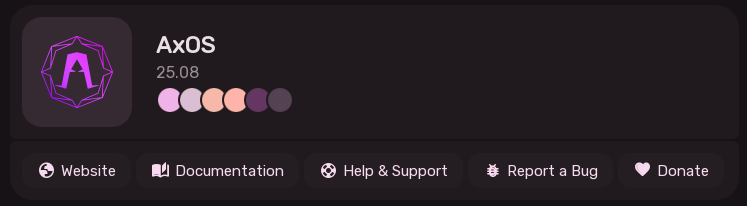
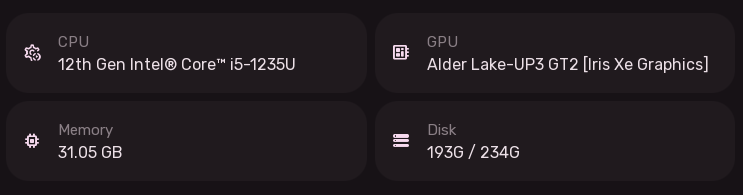

# About Sleex & System Information User Experience

The About Settings page provides a visual summary of the operating system, Linux kernel, hardware specifications, and project community resources.

---

## 1. Operating System Banner

- **Distribution Emblem**: Displays the emblem of the running Linux distribution (AxOS, Arch, NixOS, Fedora, Debian, Ubuntu, etc.).
- **Distribution Name & Version**: Heading with the OS release name.
- **Kernel & Architecture**: Current running Linux kernel release and system architecture.
- **Active Color Palette Swatch**: Displays a row of chips rendering the currently active Material 3 color variables (for aesthetic purposes).
- **Quick Links Buttons**: Some useful links.
---

## 2. Hardware Specifications Summary

Below the OS banner, the About page shows a clean hardware breakdown:

- **CPU**: Full CPU brand string and total physical/logical core count.
- **GPU**: Dedicated or integrated GPU device identifier.
- **Memory**: Installed physical RAM formatted in Gigabytes.
- **Storage**: Total storage capacity of the primary system disk.
