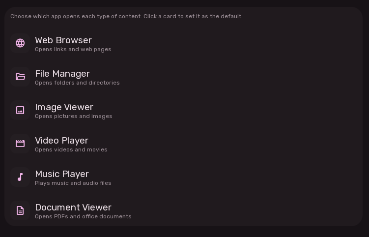

# Default Applications Settings

The Applications Settings page allows users to assign default desktop applications for standard MIME type associations and system roles.

---

## 1. System-Wide Desktop MIME Scanner

Upon loading, Sleex executes an asynchronous scanner across standard Linux desktop application paths:
- `~/.local/share/applications/*.desktop`
- `~/.local/share/flatpak/exports/share/applications/*.desktop`
- `/var/lib/flatpak/exports/share/applications/*.desktop`
- `/usr/local/share/applications/*.desktop`
- `/usr/share/applications/*.desktop`

The scanner parses `Name=`, `Icon=`, and `MimeType=` fields into categorized candidate lists, ensuring Flatpaks, local binaries, and system packages are automatically recognized.

---

## 2. Default Application Categories

Users can configure default handlers for the 6 primary content categories as well as shell developer utilities:

---

## 3. Application Selection Modal

Clicking any category dropdown opens an interactive application chooser:
- **Application Icon**.
- **Display Name**.
- **Desktop Entry Identifier**: Displays the underlying `.desktop` filename (e.g. `org.mozilla.firefox.desktop`).
- **One-Click Reassignment**: Selecting an alternative immediately updates the system MIME database via `xdg-mime default` and stores the preference.

---

## Configuration Settings Reference

| Category | Configuration Key | Default Value | Matched MIME Types |
| :--- | :--- | :--- | :--- |
| **Web Browser** | `Config.options.apps.webBrowser` | `firefox.desktop` | `x-scheme-handler/http`, `https` |
| **File Manager** | `Config.options.apps.fileManager` | `pcmanfm-qt.desktop` | `inode/directory` |
| **Image Viewer** | `Config.options.apps.imageViewer` | `org.gnome.Loupe.desktop` | `image/*` |
| **Video Player** | `Config.options.apps.videoPlayer` | `mpv.desktop` | `video/*` |
| **Music Player** | `Config.options.apps.musicPlayer` | `axuralis.desktop` | `audio/*` |
| **Document Viewer** | `Config.options.apps.documentViewer` | `onlyoffice-desktopeditors.desktop` | `application/pdf`, OpenDocument |
| **Terminal** | `Config.options.apps.terminal` | `foot.desktop` | Terminal launcher |
| **Text Editor** | `Config.options.apps.textEditor` | `code.desktop` | Text / Code editor |
