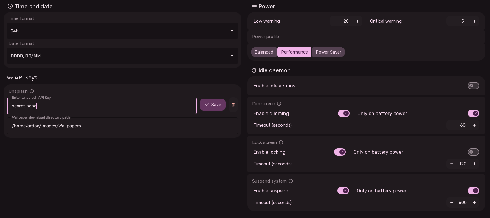

# Behavior, Power & Idle Rules User Experience

The Behavior Settings page configures eveything that affects the desktop's behavior, including time/date formats, power management, and idle daemon rules.

---

## 1. Time and Date Section

### Time Format Options
- **24h (`hh:mm`)**: 24-hour military/European format (e.g. `14:30`).
- **12h AM/PM (`h:mm AP`)**: Standard 12-hour format with meridian indicator (e.g. `2:30 PM`).

### Date Format Options
Configurable through a combobox mapped to Qt date formatting strings:
- `ddd, MMM dd` (e.g. `Tue, Oct 22`)
- `DD/MM/YYYY` (e.g. `22/10/2026`)
- `MM/DD/YYYY` (e.g. `10/22/2026`)
- `YYYY-MM-DD` (ISO format: `2026-10-22`)
- `DDDD, DD/MM/YYYY` (e.g. `Tuesday, 22/10/2026`)
- `DDDD, DD/MM` (e.g. `Tuesday, 22/10`)

---

## 2. Power & Battery Section

- **Low Warning SpinBox**: Battery percentage triggering the first notification and yellow status bar indicator (0 to 100%).
- **Critical Warning SpinBox**: Battery percentage triggering sound alerts and red status bar indicator (0 to 100%).
- **Power Profile Selector**:
  - **Balanced**: Standard everyday efficiency and performance.
  - **Performance**: Maximum clock speeds and display refresh.
  - **Power Saver**: Throttles background tasks and dims displays to extend battery life.

---

## 3. Idle Daemon (Hypnos) Section

Sleex includes an idle management daemon ([Hypnos](https://github.com/axos-project/hypnos)) with progressive timeouts for battery preservation:

### 1. Screen Dimming
- Gradually decreases backlight brightness after inactivity.
- **Timeout**: 10 to 3600 seconds.
- **Only on battery power**: When enabled, the screen will never dim while plugged into AC power.

### 2. Lock Screen
- Engages the Wayland session lockscreen automatically.
- **Timeout**: 10 to 3600 seconds.
- **Only on battery power**: Prevents locking on AC power if desired.

### 3. System Suspend
- Puts the computer into low-power sleep mode.
- **Timeout**: 10 to 3600 seconds.
- **Only on battery power**: Safe option to keep desktop running on AC while sleeping on battery.

---

## 4. API Keys & Online Services Section

The API key is used in the wallpaper selector to fetch online wallpapers from Unsplash. Users can enter their own Unsplash developer key or leave it blank to use the default shared key.

### Unsplash Wallpapers API
- **API Key Text Field**: Enter an official Unsplash key to search and download online wallpapers.
- **Save Button**: Saves the API key securely.
- **Delete Button**: Clears the saved key.
- **Wallpaper Download Directory Path**: Path where downloaded Unsplash photos are saved (default: `~/Pictures/Sleex Wallpapers/Unsplash/`).
