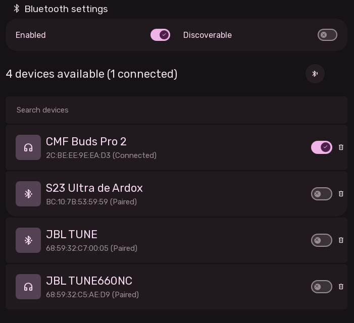
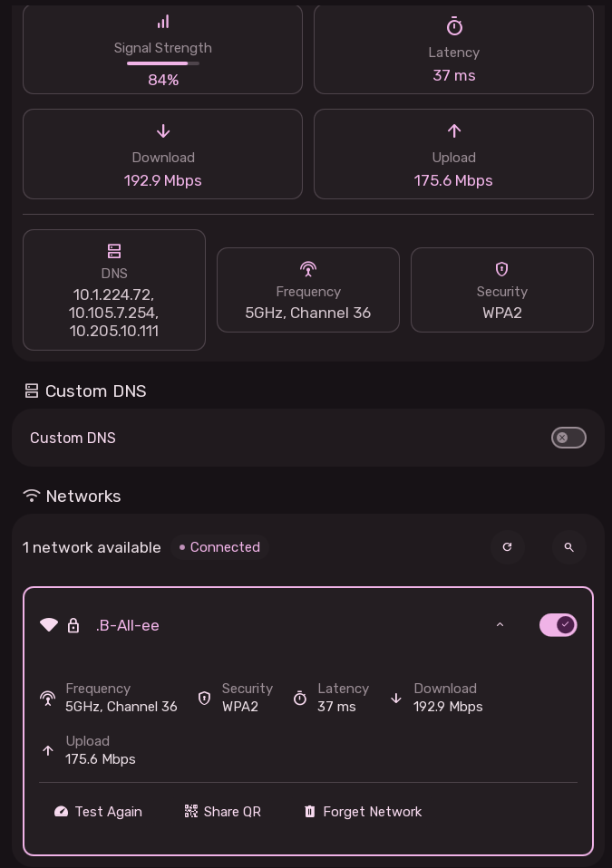

# Connectivity Settings: Bluetooth & Wi-Fi

Sleex provides dedicated, responsive configuration pages for wireless adapters.

---

## 1. Bluetooth Management

### Controls & Indicators
- **Adapter Switches**:
  - **Enabled**: Powers on/off the primary Bluetooth controller.
  - **Discoverable**: Makes the device visible to nearby phones and accessories.
- **Discover / Scan Button**: Initiates an active device discovery scan.
- **Device Type Categorization**:
  Icons adapt to device profiles automatically:
  - Headphones
  - Earbuds
  - Speakers
  - Keyboards
  - Mice
- **Device Actions**:
  - `Connect` / `Disconnect`
  - `Pair` / `Unpair`

---

## 2. Wi-Fi & Network Management

A networking center managing wireless interfaces, diagnostics, DNS security, and connection privacy.

### Active Connection Card
- Displays active SSID, signal strength icon, security encryption protocol, and precise frequency band:
  - `2.4 GHz, Channel X`
  - `5 GHz, Channel X`
  - `6 GHz, Channel X` (Wi-Fi 6E / Wi-Fi 7)

### Privacy Toggles
- **Show Connection Details**: Toggles visibility of IP, gateway, and frequency cards.
- **Show Sensitive Info**: Masks private and public IP addresses to protect privacy while screen sharing or streaming.

### Built-in Network Speed Test Tool
- Interactive benchmark tool integrated directly into Settings:
  - **Ping Benchmark**: Measures real-time round-trip latency in milliseconds (ms).
  - **Download Speed**: Multi-stream throughput test in Megabits per second (Mbps).
  - **Upload Speed**: Upstream bandwidth benchmark in Mbps.

### DNS Provider Switching
One-click switching between encrypted and privacy-respecting DNS resolvers:
- **Cloudflare** (`1.1.1.1`, `1.0.0.1`)
- **Google** (`8.8.8.8`, `8.8.4.4`)
- **Quad9** (`9.9.9.9`, `149.112.112.112`)
- **OpenDNS** (`208.67.222.222`, `208.67.222.123`)
### Available Wi-Fi Networks List
- Scans and sorts nearby access points by signal quality.
- Clicking a secured network opens a modal password prompt.
- Includes a "Forget Network" button to remove stored credentials.
