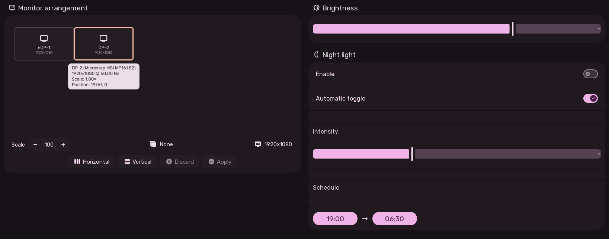

# Display Settings User Experience

The Display Settings page provides multi-monitor arrangement, display calibration, brightness controls, and blue light filtering.

---

## 1. Interactive Multi-Monitor Arrangement Canvas (`DisplaySettings.qml`)

Sleex features a spatial drag-and-drop monitor layout canvas that communicates directly with Hyprland's display manager:

### Canvas Interactions
- **Visual Display Tiles**:
  - Each physical monitor is rendered as a draggable tile labeled with its connector name (e.g. `eDP-1`, `DP-1`, `HDMI-A-1`).
  - Proportional sizing reflects actual screen resolution ratios.
- **Magnetic Edge Snapping**:
  - Displays automatically snap to adjacent edges when dragged within 20 pixels to guarantee seamless cursor transit across monitors.
- **Scale Animation**:
  - Tiles scale up slightly when clicked and dragged for tactile feedback.
- **Monitor Settings**:
  - **Resolution & Refresh Rate**: Pulled dynamically from hardware EDID modes.
  - **Display Scaling**: Configure fractional or integer HiDPI scaling (1.0x, 1.25x, 1.5x, 2.0x).
  - **Orientation / Rotation**: 0° (Normal), 90° (Portrait), 180° (Inverted), 270° (Portrait Inverted).
  - **Mirror Mode**: Clones another active display.
- **Apply Changes Bar**:
  - Pending changes are tracked in a change-set. Clicking "Apply Changes" updates Hyprland monitor keywords dynamically.

---

## 2. Brightness Section

- **Backlight Slider**:
  - Controls hardware screen backlight for the focused monitor.
  - Percentage tooltip (e.g., `75%`) displays live feedback as the slider moves.

---

## 3. Night Light (Blue Light Filter) Section

Reduces blue light emission in the evening to reduce eye strain and support sleep cycles:

- **Enable Switch**: Master switch for the blue light filter.
- **Automatic Toggle**: Activates and deactivates the filter based on the configured time schedule.
- **Time Pickers**:
  - `nightLightFrom`: Start time (default: `19:00`).
  - `nightLightTo`: End time (default: `06:30`).
  - Formats adapt automatically to 24h or 12h preferences.
- **Color Temperature Slider**:
  - Adjusts warmth from neutral daylight (`6500 K`) down to deep ember amber (`1000 K`).
