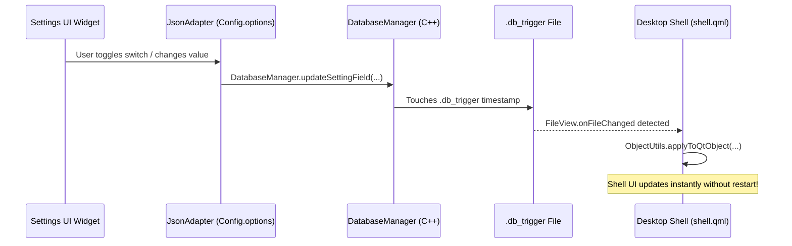

# Settings Center Architecture & Navigation Overview

The Sleex Settings Center (`src/share/sleex/settings.qml`) is a standalone Qt 6 / QML desktop application providing centralized control over appearance, layout, system behaviors, hardware devices, and network connectivity.

---

## Launching Settings

- **Desktop Launcher**: Search for "Settings" or "Sleex Settings" in the Overview / Launcher.
- **Terminal / Script**: Execute `qs -p /usr/share/sleex/settings.qml`.
- **Dashboard Button**: Click the settings gear icon in the Fullscreen Dashboard header.
- **Desktop Context Menu**: Right-click the desktop wallpaper and select "Settings".

---

## Window Structure & Navigation

The settings interface follows a modern two-pane master-detail layout:

```
+---------------------------------------------------------------------------------------------------+
|  [User Avatar] ardox           |  Style Page (Active View)                                        |
|  Logged in via Wayland         |                                                                  |
|  ----------------------------  |  Colors                                                          |
|  🎨 Style                      |  [ Light Mode ]   [ Dark Mode ]                                  |
|  🖥️ Interface                  |                                                                  |
|  ----------------------------  |  Material Palette                                                |
|  ⚙️ Behavior                   |  [ Auto (Tonal Spot)        ▼ ]                                  |
|  🔊 Sound                      |                                                                  |
|  📶 Bluetooth                  |  Static Colors                                                   |
|  🌐 Wi-Fi                      |  [x] Use static accent color                                     |
|  📱 Applications               |  (●) (●) (●) (●) (●) (●) (●) (●) (●)                             |
|  🖥️ Display                    |                                                                  |
|  🔒 Security                   |  Wallpaper                                                       |
|  ----------------------------  |  Transition Style                                                |
|  🛡️ Privacy                    |  [ Wipe                     ▼ ]                                  |
|  ℹ️ About                      |                                                                  |
+---------------------------------------------------------------------------------------------------+
      Navigation Sidebar (250px)                            Content Pane (Dynamic Loader)
```

### 1. User Header (`SettingUserInfo.qml`)
- Located at the top of the sidebar.
- Displays the user's profile avatar (`Config.options.dashboard.avatarPath`), system username, and host environment.

### 2. Sidebar Navigation (`settings.qml:37-51`)
The sidebar organizes configuration into 11 distinct sections separated by subtle category dividers:

| Page Name | Icon | Category | QML Component |
| :--- | :--- | :--- | :--- |
| **Style** | `palette` | Visuals | `modules/settings/Style.qml` |
| **Interface** | `space_dashboard`| Layout | `modules/settings/Interface.qml` |
| *Divider* | — | — | — |
| **Behavior** | `settings` | System | `modules/settings/BehaviorConfig.qml` |
| **Sound** | `brand_awareness`| Audio | `modules/settings/Sound.qml` |
| **Bluetooth** | `bluetooth` | Connectivity | `modules/settings/Bluetooth.qml` |
| **Wifi** | `wifi` | Connectivity | `modules/settings/Wifi.qml` |
| **Applications**| `apps` | Software | `modules/settings/Applications.qml` |
| **Display** | `display_settings`| Hardware | `modules/settings/Display.qml` |
| **Security** | `lock` | Authentication| `modules/settings/Security.qml` |
| *Divider* | — | — | — |
| **Privacy** | `lock` | Privacy | `modules/settings/Privacy.qml` |
| **About** | `info` | System Info | `modules/settings/About.qml` |

### 3. Animated Content Loader
When clicking a navigation item, the main view executes a crossfade transition (`switchAnim`):
- Previous page fades out with `elementMoveExit` easing (150 ms).
- Selected page loads asynchronously (`asynchronous: true`) to maintain 60 FPS responsiveness.
- Incoming page fades in with `elementMoveEnter` easing (250 ms).

---

## Reactive Configuration Engine (`Config.qml`)

Sleex utilizes a reactive JSON database architecture rather than static text files:



- **Instant Visual Feedback**: Modifying any toggle, slider, or combobox in Settings immediately broadcasts the change to the active desktop shell.
- **Persistent Storage**: All settings are automatically serialized to JSON and persisted to `~/.config/sleex/` by `DatabaseManager`.
