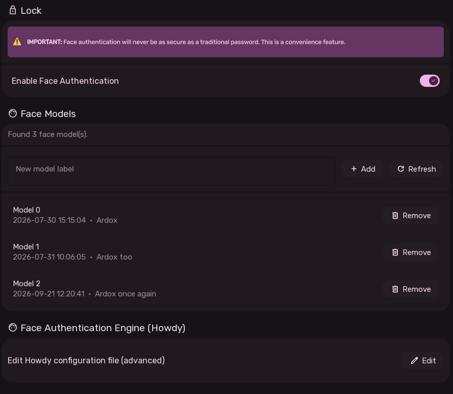
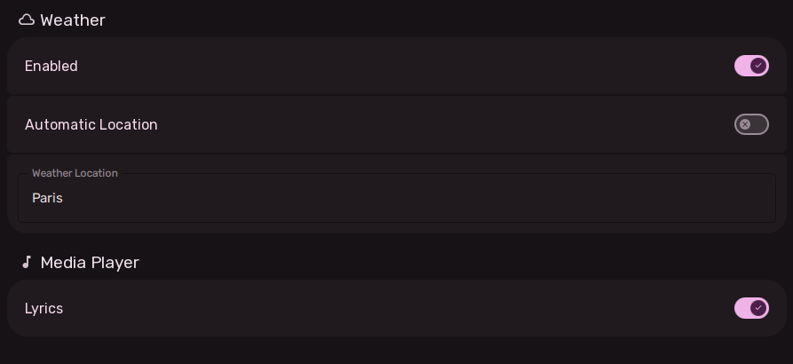

# Security & Privacy Settings User Experience

The Security and Privacy Settings pages manage biometric facial authentication and data privacy controls.

---

## 1. Security: Howdy Facial Authentication (`Security.qml`)

Sleex integrates with **Howdy** to provide Windows Hello-style facial authentication on Wayland using IR or standard webcams.

**NOTE: Facial recognition is inherently less secure than strong passwords or hardware security keys. This is more of a convenience feature than a security measure.**

### Model Management UX
- **Live Status Feed**: Shows model load state, camera discovery status, and active capture progress.
- **Enrolled Models List**:
  - Displays ID, creation timestamp, and user label for each enrolled face scan.
  - **Delete Button**: Prompts with confirmation deletes obsolete models.
- **Adding a New Face Model**:
  - Enter a descriptive label (e.g. "Work Desk", "Dim Lighting", "With Glasses").
  - Clicking "Add Model" initiates the enrollment process.
  - Look at the camera until your model appears in the list.

---

## 2. Privacy Settings

Allows users to control what personal or environmental data is shared with online API providers:

### Weather Privacy Controls
- **Weather Forecast Toggle**: Master toggle for weather widgets across the dashboard and desktop background.
- **Automatic Location Toggle**:
  - When enabled, uses IP-based geolocation to query local weather forecasts without storing GPS coordinates.
- **Manual City / Coordinate Override**:
  - When automatic location is turned off, a text input appears allowing users to manually enter a city or region name, preventing transmission of their IP location.

### Media Player Lyrics Privacy
- **Synced Lyrics Toggle**:
  - Controls whether the media player queries online providers (LRCLIB) for live synchronized lyrics during music playback.
  - Disabling this prevents outgoing queries with artist and song metadata.
