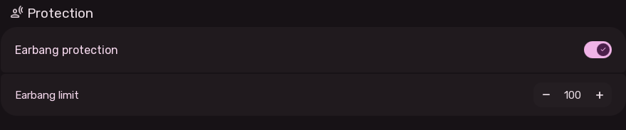
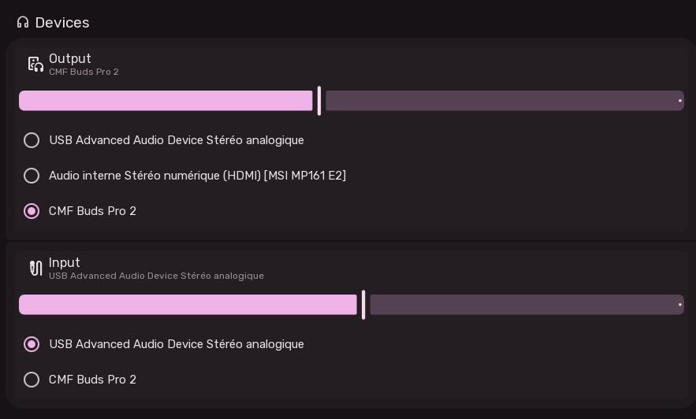

# Sound Settings

The Sound Settings page (`src/share/sleex/modules/settings/Sound.qml`) configures hearing safety, audio input/output devices, per-application volume mixing, and system chimes via **Pipewire** and **WirePlumber**.

---

## 1. Hearing Protection (Earbang Protection)

A dedicated safety system to protect users from dangerous volume spikes when connecting headphones or switching streams:

- **Earbang Protection Switch**:
  - Restricts volume step jumps to a safe maximum increase (`maxAllowedIncrease: 10%`).
  - Caps overall master output at a strict threshold so media cannot accidentally play at 100%.
- **Earbang Limit SpinBox**:
  - Sets the maximum volume ceiling (default: 85–100%).
  - If a user attempts to increase volume beyond this limit via hotkeys, the OSD flashes an orange warning and holds the level at the cap.

---

## 2. Audio Devices Management

Interactive buttons displaying active hardware sinks (speakers/headphones) and sources (microphones):

### Selecting Output & Input Devices
- Clicking either button opens the **Audio Device Selector Dialog**:
  - Lists all active Pipewire audio nodes discovered on the system.
  - Highlights the currently active default sink/source.
  - Clicking any alternative hardware node (e.g., USB DAC, Bluetooth headset, HDMI audio) immediately reroutes system audio.
  - Pressing `Escape` or clicking outside dismisses the selector.

---

## 3. Per-Application Volume Mixer

Direct control over volume levels of running applications playing audio:

- **Automatic Stream Detection**: Real-time binding to Pipewire audio stream nodes (`node.isSink && node.isStream`).
- **Application Identifiers**: Displays the application name and icon for each audio stream.
- **Independent Sliders**: Adjust individual media volume without modifying master hardware volume.
- **Mute Toggles**: Instantly mute or unmute specific background programs with a single click.

---

## 4. System Sounds Section

- **Battery Notification Sounds**:
  - Toggles audible chimes when battery warnings (low, critical, charger connected/disconnected) fire.
