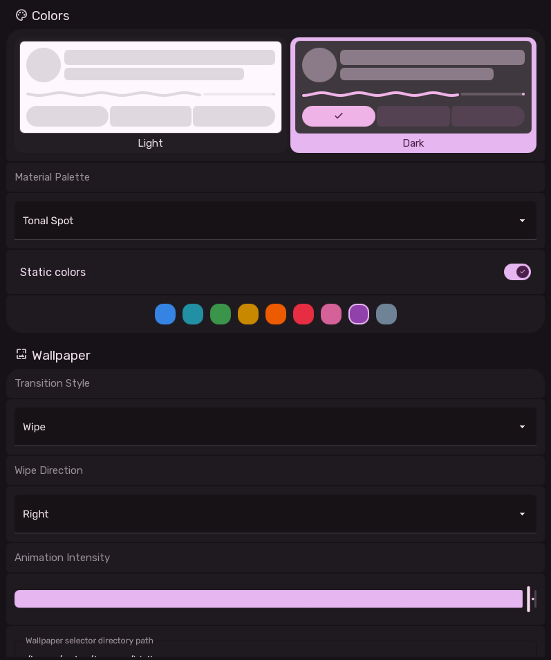

# Style Settings

The Style Settings page configures theme colors, Material 3 dynamic color generation palettes, static accent colors, and wallpaper transition behavior.

---

## 1. Color Management Section

### Light vs Dark Mode Preference
- Two elevated buttons allow one-click toggling between Light and Dark desktop themes.
- Selecting Dark adjusts the luminance of surface layers, text colors and border contrasts.

### Material 3 Dynamic Palette Types
When dynamic colors are enabled, Sleex uses Google's Material Color Utilities to extract an algorithmic color scheme from the active wallpaper. Users can pick from 9 distinct extraction schemes:

| Palette Scheme | Internal Value | Visual Character |
| :--- | :--- | :--- |
| **Auto** | `"auto"` | Automatically picks the most balanced scheme based on image properties. |
| **Content** | `"scheme-content"` | Directly matches the dominant colors found in the wallpaper image. |
| **Expressive** | `"scheme-expressive"` | Introduces vibrant complementary and tertiary accent hues. |
| **Fidelity** | `"scheme-fidelity"` | High color fidelity preserving exact wallpaper color relationships. |
| **Fruit Salad**| `"scheme-fruit-salad"`| Playful, contrasting warm and cool secondary tones. |
| **Monochrome** | `"scheme-monochrome"` | Sophisticated grayscale with zero color saturation. |
| **Neutral** | `"scheme-neutral"` | Low saturation, subtle earth tones ideal for minimalist setups. |
| **Rainbow** | `"scheme-rainbow"` | High-energy saturated accent variations. |
| **Tonal Spot** | `"scheme-tonal-spot"` | Google's default Material You palette with soft pastel undertones. |

### Static Colors Mode
- When enabled, dynamic color extraction from the wallpaper is bypassed in favor of a fixed, consistent accent hue.
- **Predefined Palette Chips**:
  Users can choose from 9 curated hex colors:
  - Blue (`#3584E4`)
  - Cyan / Teal (`#2190A4`)
  - Green (`#3A944A`)
  - Amber / Gold (`#C88800`)
  - Orange (`#ED5B00`)
  - Red (`#E62D42`)
  - Pink (`#D56199`)
  - Purple (`#9141AC` - Sleex Default)
  - Slate / Navy (`#6F8396`)

---

## 2. Wallpaper & Transition Section

### Transition Style
- **Fade**: Classic crossfade transparency.
- **Scale**: Smooth zoom effect from `1.15x` scale down to native `1.0x`.
- **Wipe**: Directional reveal wipe across the display.

### Wipe Direction
When `Wipe` transition is selected, a secondary combobox dynamically appears allowing users to select:
- **Left**
- **Right**
- **Up**
- **Down**

### Wallpaper Directory Path
- Text input specifying which directory is scanned by the Wallpaper Selector dialog (default: `/usr/share/backgrounds/sleex/`).

### Interactive Wallpaper Preview Card
- Renders a live preview thumbnail of the currently active wallpaper (both image and video wallpapers supported).
- Hovering over the preview reveals a scrim overlay with an edit pencil icon.
- Clicking the preview triggers the wallpaper switcher script to cycle to the next wallpaper immediately.
