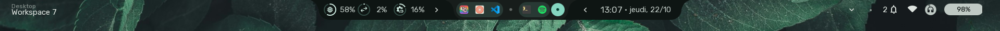

# Top Status Bar

The Sleex Status Bar serves as the primary desktop control center and visual information hub. Positioned at the top of the display, it blends workspace switching, active window tracking, global menus, system tray items, and hardware monitors into a clean, unified surface.



---

## Layout & Section Breakdown

The bar is divided into three distinct visual regions:

```
+----------------------------------------------------------------------------------------------------+
| [Workspaces] [App Title / AppMenuBar]  |  [Date & Time Island]  |  [Resources] [Tray] [Status Icons] |
+----------------------------------------------------------------------------------------------------+
       Left Region (Navigation)             Center Region (Clock)          Right Region (System Info)
```

---

## 1. Left Region: Navigation & Applications

### Active Window Title
- Displays the title or application name of the currently focused window.
- Automatically elides and shortens text on narrower screen resolutions.
- Can be toggled on or off via Settings.
- Scrolling the mouse wheel over the title bar increases or reduces the brightness of the active screen (if supported by the hardware).

### Global Application Menu Bar
- Integrates a desktop menu bar (File, Edit, View, Help) directly into the status bar:
  - Communicates with running applications using the **DBusMenu** protocol.
  - Falls back to application desktop entry quick actions (e.g., "New Tab", "New Window", "Incognito") if the client application does not export a native DBusMenu.
  - Clicking any menu item opens a dropdown menu with submenus, keyboard shortcut hints, and separators.

---

## 2. Center Region: The Dynamic Island

### Resources usage
- Displays metrics for CPU, RAM, and SWAP usage in real time.
    - Each resource is represented by a circular progress indicator.
    - Hovering over any resource icon reveals a tooltip with the exact percentage and absolute values (e.g., "CPU: 45%").

### Workspaces Switcher
- **Workspace Dots & Numbers**: Displays available Hyprland workspaces (configurable from 1 to 30).
- **Dynamic Icon Modes**:
  - **Material Icons Mode**: Displays minimalistic geometric dots and Material symbols for active workspaces.
  - **App Icons Mode**: Pulls the running application's desktop icon into the workspace badge so users immediately know which apps live where.
- **Hold-to-Reveal Numbers**:
  - Holding down the `SUPER` key reveals workspace numbers (1, 2, 3...) in place of icons.
  - The reveal delay is configurable (default: 300 ms) to avoid visual flicker during quick shortcut execution.
- **Scroll Switching**: Scrolling the mouse wheel or touchpad over the workspaces area shifts active workspace left or right.
- **Click Switching**: Clicking any workspace dot instantly switches to that workspace.

### Date & Time
- Displays the current date and time
- Hovering over the date and time opens a small popup with
  - **Uptime**: Shows how long the system has been running since the last boot.
  - **Upcoming tasks**: List of scheduled tasks from the TODO list.

Right-clicking the area will open the application launcher.

---

## 3. Right Region: Hardware & Status Indicators

### System Tray
- Implements the **StatusNotifierItem (SNI)** Wayland tray specification.
- **Monochrome Icon Filtering**: Optional filter converts third-party tray icons into clean monochrome symbols matching the theme palette.
- **Right-Click Menus**: Native Wayland context menus rendered using Material styling.

### Hardware Status Popups & Toggles
- **Battery Indicator**:
  - Live battery charge percentage, charging lightning glyph, and time-to-full/time-to-empty calculations.
- **Bluetooth Indicator**:
  - Displays connected device icons (headphones, mice, keyboards) and battery levels.
- **Network Indicator**:
  - Shows Wi-Fi signal strength and connection status.
- **Notification Indicator**:
  - Bell icon with unread badge counter.

- Clicking the area opens the dashboard.
- Right-clicking the area will go to the next song if a media player is running.