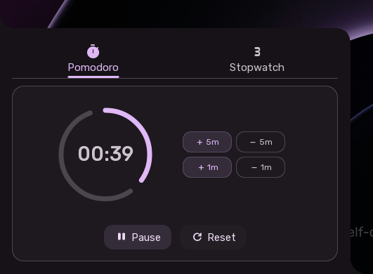

# Corner Popup

The Sleex Corner Popup is a slide-out productivity drawer discreetly located in the bottom-left corner of the screen. It provides quick access to time-management tools without taking up desktop space.

---

## Reveal & Hide Interaction

- **Hover to Reveal**: Move the mouse cursor to the bottom-left corner of the screen. A small 20x20 pixel trigger expands smoothly into a floating card with rounded corners.
- **Automatic Collapse**: Moving the cursor away from the card automatically collapses it back into the corner edge.

---

## Tabs Overview

The card features two primary tabs accessible via the tab bar at the top:

1. **Pomodoro**: Focus timer with interval adjustments and notifications.
2. **Stopwatch**: Millisecond-accurate timer with lap recording.

---

## 1. Pomodoro Focus Timer

The Pomodoro tab helps you manage work and study intervals through structured sessions and breaks:

- **Timer Display**: Large digital readout showing the remaining minutes and seconds.
- **Quick Adjustments**: Convenient buttons to tweak the session length on the fly:
  - **+5m / -5m**: Add or remove 5 minutes.
  - **+1m / -1m**: Add or remove 1 minute.
- **Controls**:
  - **Start / Pause**: Begins or pauses the countdown.
  - **Reset**: Restores the timer to its initial duration.
- **Notifications**: Sends a desktop alert when a work interval or break is finished.

---

## 2. Precision Stopwatch

The Stopwatch tab provides a stopwatch for measuring elapsed time:

- **Millisecond Display**: High-precision digital time readout tracking minutes, seconds, and milliseconds.
- **Controls**:
  - **Start / Pause**: Starts or pauses time tracking.
  - **Lap**: Records the current split time into the laps list while the timer continues running.
  - **Reset**: Stops and zeroes the stopwatch.
- **Laps List**: A scrollable history of recorded split times displayed below the timer controls.
