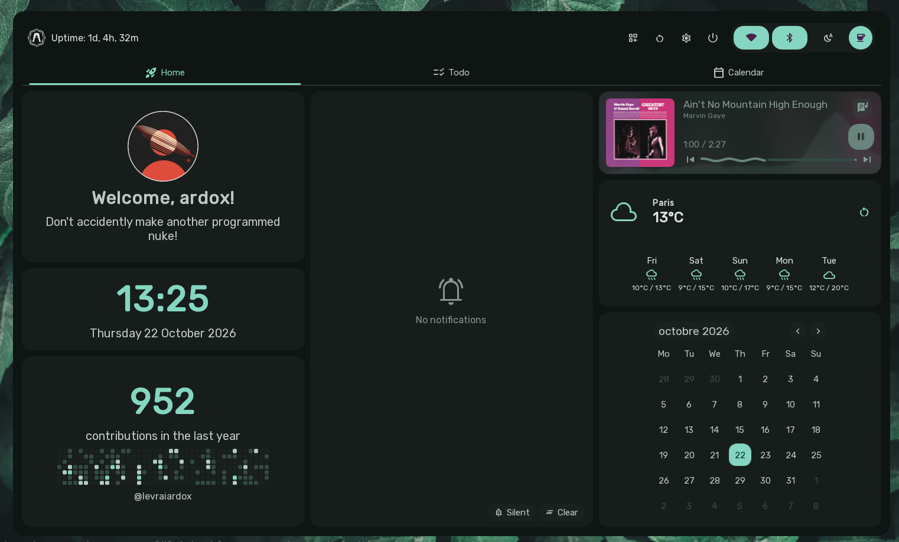

# Dashboard

The Sleex Dashboard is a full-featured, modular overlay providing instant access to personal widgets, system quick toggles, task lists, calendar agendas, and other useful tools.

---

## Invoking & Dismissing the Dashboard

- **Keyboard Shortcut**: `SUPER + D` (toggles open/close).
- **Mouse Action**: Clicking the right section of the status bar trigger.
- **Dismissal**:
  - Pressing `Escape`.
  - Clicking anywhere on the transparent backdrop outside the dashboard card.
- **Entrance & Exit Animations**:
  - The dashboard card smoothly animates in from a user-configured direction (`up`, `down`, `left`, `right`) with adjustable speed.

---

## Dashboard Header & Quick Controls

The top header of the dashboard features a system status bar and essential quick controls:

### 1. System Information
- **Distribution Badge**: Displays the active OS emblem (AxOS, Arch, Fedora, NixOS, Debian, etc.).
- **Uptime Counter**: Live counter formatted cleanly via `DateTime.uptime`.

### 2. Header Utility Buttons
- **Bento Layout Customizer**: Enters interactive edit mode for the Bento widget grid.
- **Reload Desktop**: Reloads Hyprland and Quickshell configs without closing open windows.
- **Open Settings**: Launches the Sleex Settings application.
- **Session Actions**: Triggers the session management overlay.

### 3. Quick Toggles Group
Compact pill buttons with real-time state feedback and tooltips:
- **Network Toggle**: Toggles Wi-Fi or displays active SSID and connection state.
- **Bluetooth Toggle**: Master toggle for Bluetooth adapter power.
- **Night Light**: Toggles the blue light temperature filter.
- **Idle Inhibitor**: Prevents the screen from dimming or sleeping.
- **Game Mode**: Suppresses background notifications and locks idle timers for gaming sessions.

---

## Modular Grid System

The **Home** view of the dashboard is built on a responsive 10-row grid layout.

### Interactive Customization Mode
Clicking the `dashboard_customize` button in the header enters edit mode:
- **Drag-and-Drop Repositioning**: Click and hold the drag handle on any widget to move it into another slot.
- **Drop Placeholders**: Clear visual drop targets show valid snap positions.
- **Widget Sizing Presets**: Use predefined grid spans (e.g., `1x2`, `1x3`, `2x2`, `2x4`, `1x10`) to customize layout proportions.
- **Add / Remove Widgets**: Toggle widgets on and off using the customization drawer.

### Default Widgets Breakdown

1. **User Profile Widget**:
   - Displays user profile avatar, system username, and a personalized description / quote.
2. **Digital Clock Widget**:
   - Modern large typography digital clock, current seconds ticker, and complete date.
3. **GitHub Heatmap Widget**:
   - Fetches and displays public GitHub contribution history graph.
   - Reacts to username set in settings.
4. **Notification Center**:
   - Chronological list of historical and unread desktop notifications.
   - Grouping by application with expandable threads.
   - "Clear All" button and inline notification action buttons.
   - "Silent" button to hide notification popups.
5. **Media Player Widget**:
   - Displays current media playing across any MPRIS-compliant player (Spotify, Firefox, mpv, etc.).
   - Album artwork, track name, artist, previous/play/pause/next buttons, and interactive progress scrub bar.
   - Lyrics mode displays synchronized lyrics if available via LRCLIB.
6. **Weather Widget**:
   - Real-time weather condition icons, temperature (°C/°F), and forecast powered by Open-Meteo.
7. **Calendar Agenda Widget**:
   - A calendar. No more no less.

---

## Secondary Dashboard Tabs

In addition to the Bento Home tab, users can switch tabs via the top tab bar:

### 1. Todo List Tab
- **Add Tasks**: Clean text field to enter new to-do items.
- **Task Management**: Check off completed items, reorder tasks, and remove items with a single click.
- **Persistent Storage**: Tasks persist across reboots via the Sleex database service.

### 2. Calendar & Agenda Tab
- **Full Monthly Grid**: Interactive month navigation with today highlight.
- **Event Management**: Create, edit, and categorize calendar events with start/end times.
- **CalDAV Synchronization**: Integrates with `vdirsyncer` for background two-way syncing with Nextcloud, Google Calendar, or Radicale (`syncInterval` configurable from 1 to 1440 minutes).