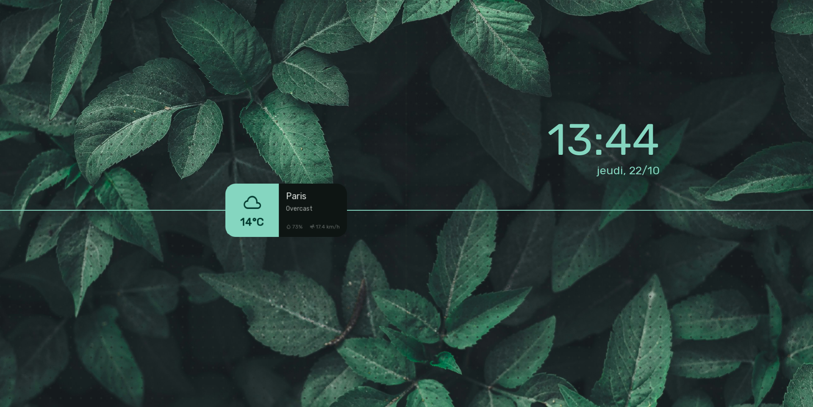

# Desktop

The Sleex Desktop transforms the desktop into an interactive surface featuring dynamic wallpaper transitions, draggable widgets, desktop icons, and customizable typography.

---

## Dynamic Wallpaper Engine

The background subsystem seamlessly renders both high-resolution static images and animated video wallpapers with cinematic transitions:

### Transition Effects
When changing wallpapers via the shell, settings, or CLI scripts, Sleex executes smooth animations between the old and new wallpapers:

- **Fade**: Crossfades opacity smoothly between the old and incoming wallpaper.
- **Scale**: Smoothly zooms in the incoming wallpaper from `1.15x` scale down to native `1.0x` while crossfading.
- **Wipe (Left, Right, Up, Down)**: Performs a directional wiping reveal across the display using hardware-accelerated clipping rects.

---

## Interactive Desktop Widgets

Positioned directly on the desktop canvas are modular widgets that can be enabled, disabled, and positioned:

### 1. Desktop Clock Widget
- **Large Typographic Presentation**: Displays current time and date in bold, elegant typography.
- **Clock Mode**: Choose between `light` (primary accent color) and `dark` (deep tone) in the settings.
- **Custom Font Selection**: Users can select any font family installed on the system (e.g., *Rubik*, *Inter*, *JetBrains Mono*, *Fira Code*) via the settings.
- **Smart Alignment**: Automatically aligns text left, center, or right depending on whether it is positioned on the left, center, or right third of the display.

### 2. Live Weather Widget
- Positioned on the desktop canvas showing current local temperature and weather condition icons.

### 3. Sticky Notes
- On-desktop notepad allowing users to write quick reminders, notes, and scratchpad tasks.
- Can be dragged anywhere across the desktop grid. Contents persist across reboots.

### 4. Community Daily Quote Widget
- Renders inspiring technology, programming, and open-source quotes on the desktop.
- **Dual Sources**:
  - **Local (0)**: Curated tech quotes written by the AxOS community, stored in `/usr/share/sleex/assets/quotes.json`.
  - **Online (1)**: Dynamically fetched quotes from online API providers.

### 5. Desktop Watermark
- Subtle branded watermark anchored to the bottom-right corner of the canvas.
- Shows the current OS distribution with it's version and the Sleex version number.

---

## Desktop Icons & Context Menus

Sleex features a desktop file and launcher grid with full mouse interaction:

### Desktop Files & Launchers
- Reads files and folders placed in the user's `~/Desktop` directory.
- Double-clicking an icon opens the file in its default application or launches the program.
- Drag-and-drop icon arrangement with grid snapping.

### Right-Click Context Menus
- **Item Context Menu**:
  - Open / Launch.
  - Open with... (application chooser).
  - Rename file.
  - Move to Trash / Delete.
- **Desktop Background Context Menu**:
  - Right-clicking empty space on the wallpaper brings up quick actions:
    - Open Terminal.
    - Open Sleex Settings.
    - Open Session Manager.
    - Show desktop icons.
    - Add New Note (spawns a Post-it sticky note).