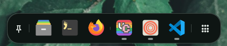

# Application Dock

The Sleex Application Dock provides a modern, sleek app launcher and task switcher resting at the bottom of the active display.

---

## Visual Design & Geometry

The dock is rendered as an elevated floating pill with rounded corners, subtle outline stroke, and surface elevation shadowing:

- **Configurable Dimensions**:
  - Dock height (default: 60 px).
  - Hover trigger threshold (default: 3 px).
- **Responsive Item Spacing**:
  - Pinned applications and active running windows are organized neatly with horizontal spacing and smooth hover scale feedback.

### Pinned Applications
- Clicking a pinned application launches the program if it is not running, or focuses its primary window if already open.
- Right-clicking an application with pin or unpin it. 

### Running App Indicators
- Applications currently open on any workspace appear on the right side of the dock separator.
- Visual indicator dots below the icon indicate how many windows are active for that application.

Hovering an application icon reveals a small preview of all open windows for that application. Clicking a window in the preview focuses it.

---

## Visibility & Reveal Behaviors

The dock supports three distinct modes of operation:

### 1. Pinned on Startup
- When pinned, the dock reserves an exclusive bottom margin on the display.
- Tiled application windows in Hyprland automatically avoid overlapping the dock.

### 2. Hover-to-Reveal
- The dock slides down off-screen, leaving an invisible 3 px trigger region at the bottom edge.
- Moving the cursor to the bottom edge smoothly animates the dock into view.
- Moving the mouse away automatically retracts the dock after a brief delay.

### 3. Smart Reveal on Empty Workspace
- When hover-to-reveal is disabled and the dock is unpinned, Sleex detects whether the current workspace contains any focused windows.
- If the workspace is empty (viewing only the desktop wallpaper), the dock stays visible automatically.
- When an application window takes focus, the dock gracefully hides to maximize usable screen real estate.
