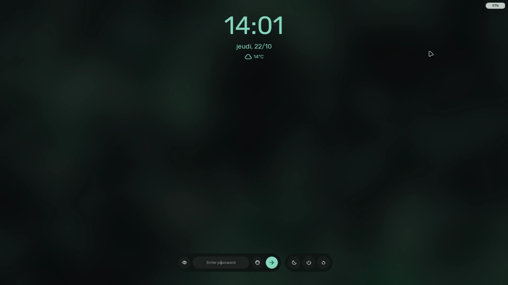
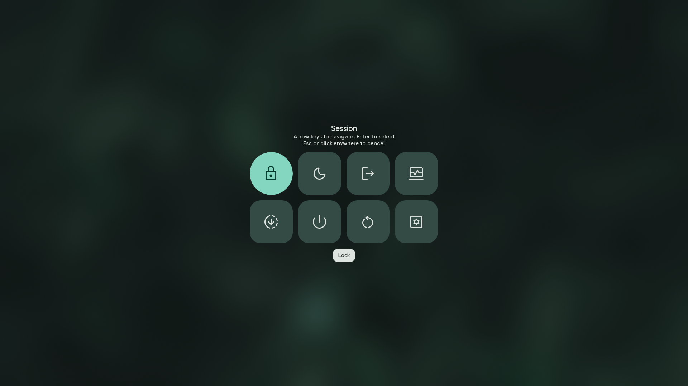

# Lockscreen & Session Controls

Sleex delivers a secure Wayland lockscreen and an integrated session power management system.

---

## 1. The lockscreen

The Sleex lockscreen uses the official Wayland `ext-session-lock-v1` protocol via Quickshell's `WlSessionLock`. When locked, unauthorized windows and input are prevented from reaching the compositor.

### Triggering the Lockscreen
- **Shortcut**: `SUPER + L`.
- **Idle Daemon**: Automatically locks upon reaching user-defined idle timeouts (configured in Behavior settings).
- **Session Menu**: Selecting the "Lock" action from the power menu.

### Visual & Interactive Elements
1. **Background Scrim & Blur**:
   - The desktop background is displayed with configurable scrim darkening and blur.
2. **Clock & Date Header**:
   - Large digital clock and current date positioned at the top of the display.
3. **Authentication Card**:
   - **Password Field**: Clean password input field with immediate focus.
   - **Failure Animation**: Incorrect password entry triggers a horizontal shake animation and highlights the input border in error red.
4. **Howdy Facial Recognition Integration**:
   - When enabled, the lockscreen interfaces with the camera via Howdy. Click on the face icon to initiate a facial scan for authentication.
5. **Lockscreen Media Controls**:
   - When enabled, active music playback can be controlled directly on the lockscreen.
   - Shows album art, track title, artist name, and playback buttons.
   - **Synced Lyrics Option**: Can display live scrolling lyrics on the lockscreen.
   - **Resizable Widget Option**: Allows resizing and dragging the media player widget to any corner of the lockscreen.

---

## 2. Session & Power Actions Menu

The Session Menu provides a full-screen, high-contrast overlay for system power states and session termination.

### Triggering the Session Menu
- **Keyboard Shortcut**: `CTRL + ALT + Delete`.
- **Dashboard Button**: Clicking the power button icon in the dashboard header.

### Available Actions

| Action | Icon | Behavior |
| :--- | :--- | :--- |
| **Lock** | `lock` | Activates the Wayland session lockscreen. |
| **Suspend** | `bedtime` | Puts the computer into low-power sleep mode via `systemctl suspend`. |
| **Hibernate** | `mode_heat` | Saves RAM state to disk and powers down via `systemctl hibernate`. |
| **Restart** | `restart_alt` | Reboots the system via `systemctl reboot`. |
| **Power Off** | `power_settings_new`| Shuts down the machine cleanly via `systemctl poweroff`. |
| **Log Out** | `logout` | Terminates the active Hyprland session and returns to the display manager. |

### Confirmation Guards
To prevent accidental reboots or data loss during active work:
- Pressing the power button on the device triggers a confirmation dialog.
- The confirmation dialog clearly displays the target action with "Confirm" and "Cancel" buttons.
- Pressing `Escape` or clicking outside the card cancels the pending action and dismisses the menu.
