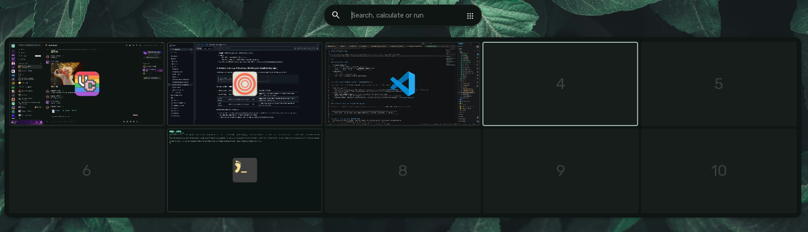
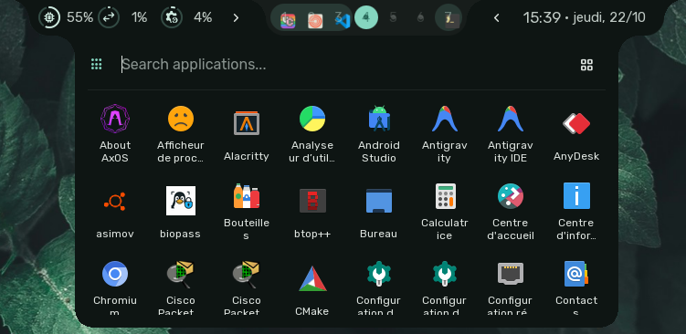

# Overview & App Launcher

The Sleex Overview combines a multi-workspace window switcher with an omnibar universal search system.
The App Launcher is a modern, fuzzy-searchable application menu integrated into the Overview.

---

## Invoking & Dismissing

- **Keyboard Trigger**:
  - Tap and release `SUPER` (Windows key) on its own.
  - `SUPER + V`: Opens directly into **Clipboard History** mode.
  - `SUPER + ;`: Opens directly into **Emoji Picker** mode.
- **Dismissal**:
  - Press `Escape`.
  - Click anywhere outside the widget.
  - Press `Enter` to launch an item or switch window.

---

## 1. Multi-Workspace Window Visualizer

When opened, the overview displays a scaled visual matrix of Hyprland workspaces:

- **Live Tiling Grid**:
  - Workspaces are rendered across rows and columns.
  - Shows live thumbnail of open windows preserving their relative tiling positions and aspect ratios.
- **Window Interaction**:
  - **Left Click Window**: Immediately closes the overview and focuses that window.
  - **Middle Click**: Terminates or closes the hovered window directly from the overview.
  - **Drag & Drop**: Click and hold a window to drag it into another workspace. Releasing the mouse button drops the window into the new workspace.
  - **XWayland Badge**: Displays a subtle indicator for windows running via XWayland translation.

---

## 2. Universal Search Omnibar

Positioned directly below the workspace matrix is an omnibar search field. It handles multi-modal queries in real time:

### Application search (No Prefix)
- Typing any text without a prefix performs rapid matching against installed desktop applications.
- Results display the app icon and application name.
- Pressing `Enter` launches the highlighted top result.
- Pressing `Down Arrow` or `Up Arrow` navigates through the search results list.

### Quick Actions (`/` Prefix)
Typing the forward slash `/` unlocks command actions built into Sleex:

| Action Command | Syntax | Behavior |
| :--- | :--- | :--- |
| **Set Accent Color** | `/accentcolor #HEX` | Instantly applies a new custom accent color across all shell surfaces. |
| **Dark Theme** | `/dark` | Forces dark mode color generation. |
| **Light Theme** | `/light` | Forces light mode color generation. |
| **Superpaste** | `/superpaste [count][i]` | Pastes the last `N` clipboard entries in sequence using `ydotool` (append `i` for images). |
| **Add Todo** | `/todo [task description]` | Appends a new item to the user's dashboard todo list without opening the dashboard. |
| **Wallpaper Picker** | `/wallpaper` | Opens the visual Wallpaper Selector modal. |
| **Wipe Clipboard** | `/wipeclipboard` | Purges all stored history from `cliphist`. |

### Clipboard History Browser (`;` Prefix or `SUPER + V`)
- Typing `;` or pressing `SUPER + V` switches the search widget into the **Clipboard Browser**:
  - Queries `cliphist` for recent text snippets and copied images.
  - Real-time search filters through copied text contents.
  - Image thumbnails preview copied screenshots or pictures.
  - Pressing `Enter` copies the selected item to the active clipboard buffer and closes the launcher.

### Emoji Picker (`:` Prefix or `SUPER + ;`)
- Typing `:` or pressing `SUPER + ;` activates the **Emoji Search**:
  - Search by emoji keywords (e.g. `:rocket`, `:heart`, `:fire`, `:check`).
  - Selecting an emoji automatically copies it to the clipboard and pastes it into the active window.

### Real-Time Math Calculator
- Any mathematical formula typed into the search bar (e.g. `12 * 8.5`, `sqrt(144) + 2^5`, `15% of 350`) is evaluated in real time via `qalc`:
  - The calculated result appears as the top primary search result.
  - Pressing `Enter` copies the computed answer to your clipboard.
  - The calculator also supports unit conversions (e.g., `5 miles to km`, `100 USD to EUR`, `32 F to C`).