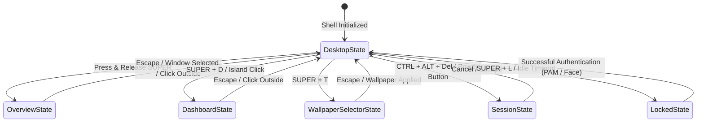

# Desktop Shell Architecture & Interaction Model

The Sleex Desktop Shell runs as an integrated Wayland layer-shell environment powered by **Quickshell**. It creates a cohesive, reactive desktop interface synchronized with the **Hyprland** window manager.

---

## Wayland Layer-Shell Surfaces

Sleex utilizes Wayland's `wlr-layer-shell` protocol to render UI components on different visual planes relative to application windows:

| Layer | Component | Shell Namespace | Behavior & Interaction |
| :--- | :--- | :--- | :--- |
| **Background** (`WlrLayer.Bottom`) | Desktop Canvas | `quickshell:background` | Renders wallpaper, desktop icons, clock, and sticky notes behind all client windows. Receives clicks and context menu events when the desktop is clicked. |
| **Top** (`WlrLayer.Top`) | Status Bar | `quickshell:bar` | Positioned at the top or bottom of the screen. Reserves exclusive desktop zone or auto-hides upon mouse hover. |
| **Top** (`WlrLayer.Top`) | Application Dock | `quickshell:dock` | Positioned at the bottom screen edge. Automatically slides in/out based on workspace occupation and mouse hover. |
| **Overlay** (`WlrLayer.Overlay`) | Dashboard | `quickshell:dashboard` | Fullscreen modal panel presenting the modular Bento grid, quick toggles, and widgets. Captures exclusive keyboard focus. |
| **Overlay** (`WlrLayer.Overlay`) | Overview & Launcher | `quickshell:overview` | Multi-workspace visualizer and search input. Dismissed on `Escape` or clicking the backdrop. |
| **Overlay** (`WlrLayer.Overlay`) | Session Menu | `quickshell:session` | Power dialog overlay with shutdown, reboot, and logout confirmation guards. |
| **Overlay** (`WlrLayer.Overlay`) | Corner Drawer | `quickshell:cornerPopup` | Unobtrusive bottom-left hotspot expanding on hover to reveal Pomodoro and Stopwatch timers. |
| **Overlay** (`WlrLayer.Overlay`) | Notifications & OSD | `quickshell:notifications` | Floating toast alerts and centered volume/brightness change indicators. |
| **Session Lock** | Screen Locker | `WlSessionLockSurface` | Native Wayland session lock preventing access until PAM or Howdy authentication succeeds. |

---

## Global State Coordination (`GlobalStates.qml`)

Sleex manages shell-wide state through the `GlobalStates` singleton (`src/share/sleex/GlobalStates.qml`). This singleton orchestrates mutual exclusivity, focus grabbing, and inter-process communication (IPC):

### Key State Properties

- `GlobalStates.overviewOpen`: Active when the window switcher and universal search launcher is visible.
- `GlobalStates.dashboardOpen`: Active when the fullscreen Bento dashboard is opened.
- `GlobalStates.workspaceShowNumbers`: Temporarily true while the `SUPER` modifier key is held down, displaying workspace numbers instead of application icons in the status bar.
- `GlobalStates.screenLocked`: Controls the native `WlSessionLock` activation.
- `GlobalStates.screenZoom`: Smooth zooming factor via Hyprland's `cursor:zoom_factor`.

---

## Focus Grabbing & Dismissal UX

When an overlay surface opens (such as the Dashboard, Overview, or Wallpaper Selector):

1. **HyprlandFocusGrab**: Quickshell creates a Wayland input grab. All keyboard keystrokes route directly to the active overlay.
2. **Backdrop Dismissal**: Clicking anywhere outside the active widget surface immediately releases the focus grab and smoothly animates the overlay closed.
3. **Escape Key Handling**: Pressing `Escape` on any overlay sends a dismissal signal, returning focus to the active client window without disrupting the workflow.

---

## Multi-Monitor Behavior

- **Per-Monitor Panels**: The top bar and desktop background automatically instantiate across all connected screens discovered by Quickshell.
- **Screen Filtering**: Users can restrict the bar to specific monitors via `Config.options.bar.screenList` (e.g. `["eDP-1", "DP-1"]`).
- **Focused Screen Popups**: Interactive drawers like the Center Island Popup and Session Menu prioritize displaying on whichever display currently holds the active Hyprland cursor focus.

---

## Lifecycle & Shell Control

The shell daemon can be reloaded or managed on the fly:

- **Restart Shell**: `SUPER + End` (terminates active `qs` process and relaunches `qs -p /usr/share/sleex/shell.qml`).
- **Start Shell**: `SUPER + CTRL + End`.
- **Hyprland & Quickshell Sync**: Quick toggle inside the Dashboard header reloads Hyprland rules and Quickshell components simultaneously without requiring a logout.
