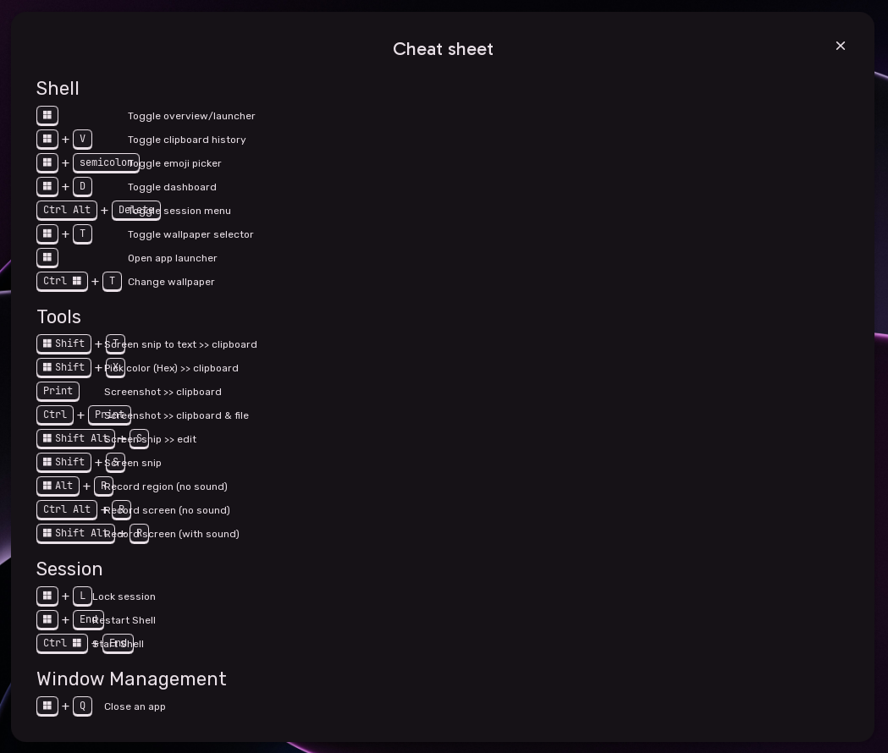
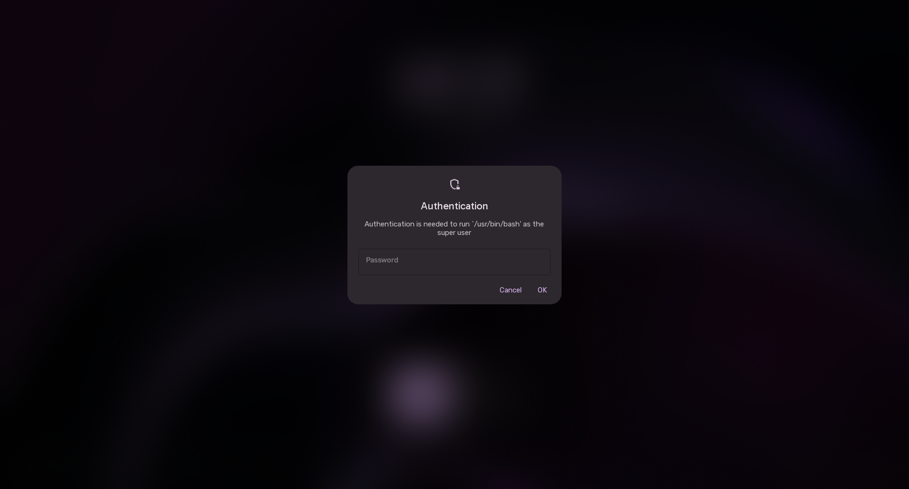

# Cheatsheet & System Dialogs

Sleex includes built-in shortcuts guidance and system prompts styled in the desktop's native Material Design theme.

---

## 1. Keyboard Shortcuts Cheatsheet

Sleex provides an interactive graphical keybind helper to make window management and navigation shortcuts easy to discover.

### Invocation & Navigation
- **Shortcut**: `SUPER + F1`.
- **Dismissal**: Press `Escape` or click anywhere on the background.

### Categorized Shortcuts
The cheatsheet automatically organizes your keybindings into clean categories:
- **Shell Dispatcher**: Desktop overlays, launchers, and system menus.
- **Window Management**: Closing, floating, tiling, and resizing windows.
- **Workspace Navigation**: Direct jumps, moving windows between workspaces, and monitor cycling.
- **Multimedia & Tools**: Screenshots, screen recording, color pickers, and audio controls.

---

## 2. Polkit Authentication Dialog

When an administrative task requires elevated root privileges (such as managing disk partitions, installing system packages, or updating display manager settings), Sleex displays a native authentication dialog:

- **Seamless Theming**: Adheres to the Material 3 surface elevation, color palette, and font styling rather than falling back to standard GNOME or KDE Polkit agents.
- **Interactive Validation**: Shows real-time feedback while verifying credentials; incorrect password entry shakes the dialog and displays clear error feedback.
- **Dismissal**: Press `Escape` or click **Cancel** to abort the authentication request.
