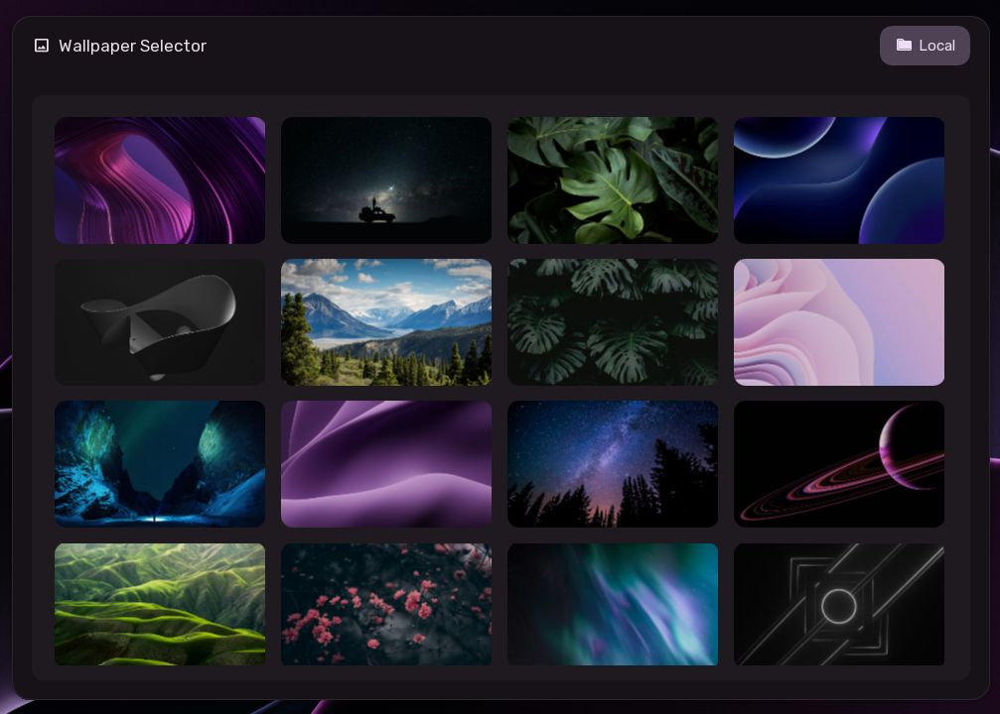

# Wallpaper Selector

The Sleex Wallpaper Selector is a visual overlay for browsing, previewing, and setting desktop backgrounds. It supports local wallpapers as well as searching and downloading high-resolution images directly from Unsplash.

---

## Invoking & Dismissing

- **Keyboard Shortcut**: `SUPER + T`.
- **Dismissal**:
  - Press `Escape`.
  - Click anywhere outside the selector window.

---

## Source Selection: Local vs. Unsplash

A toggle button in the top-right corner allows switching between two wallpaper sources:

- **Local**: Wallpapers stored on your system.
- **Unsplash**: Cloud-based catalog of high-resolution photos.

---

## 1. Local Wallpapers Mode

When in **Local** mode, the selector scans the system wallpapers directory and presents a responsive grid of 16:9 thumbnail previews:

- **Preview Grid**: Displays all available wallpapers, including static images and animated video wallpapers.
- **Hover Feedback**: Hovering over any card highlights the thumbnail with an accent border.
- **Instant Application**: Clicking a thumbnail immediately applies the wallpaper to your desktop with your configured transition effect (such as fade, scale, or wipe).
- **Dynamic Theming**: Applying a wallpaper automatically extracts a matching Material 3 color palette and updates the entire desktop theme in real time.

---

## 2. Unsplash Online Mode

The **Unsplash** tab lets you search and download millions of curated photographs without leaving the desktop.

### API Key Setup
If an Unsplash API key has not been configured yet:
- A setup screen is displayed with instructions.
- You can get a free personal API key from `unsplash.com/developers`.
- Enter the key into the input field and click **Submit**. The key is saved securely and unlocks the search interface immediately.

### Search & Browsing
Once configured, a search floating pill appears at the bottom of the screen:
- **Search Input**: Type keywords (such as *minimalism*, *architecture*, *nature*, or *cyberpunk*) and press `Enter` to search.
- **Pagination**: Navigate search results using the left and right chevron buttons, with the current page number displayed in the center.

### Downloading & Applying
- Clicking an Unsplash thumbnail shows a loading spinner while the full-resolution image downloads in the background.
- Once downloaded, the image is saved to `<XDG_PICTURES_DIR>/Sleex Wallpapers/Unsplash`, set as your active desktop wallpaper, and used to regenerate your system color scheme.
